<div align="center">

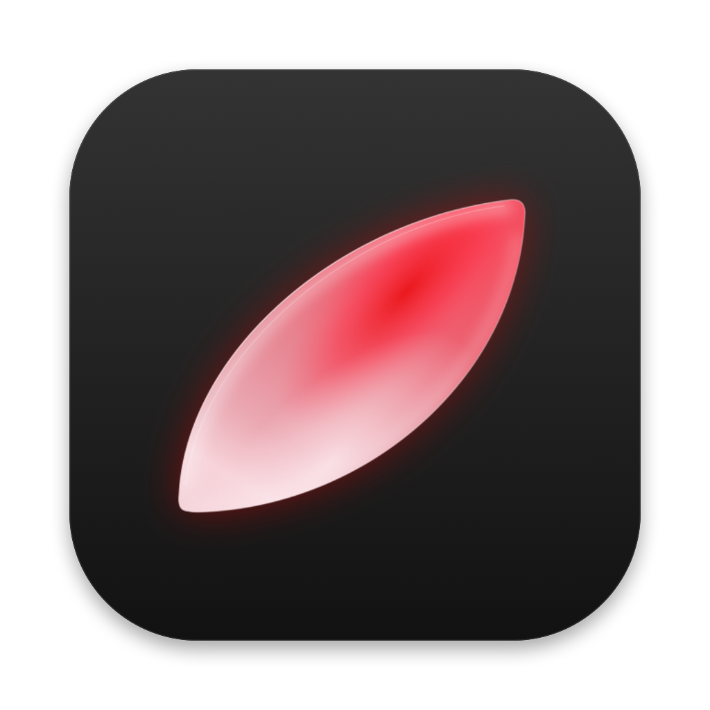

# Missing

**The features your Mac left out, in one light menu bar app.**

[**Download**](https://github.com/firewallstudio/Missing/releases/latest) · [▶ Video](design/Missing-promo.mp4) · [Install](#install) · [Shortcuts](#shortcuts) · [Suggest a feature](https://github.com/firewallstudio/Missing/issues/new?template=feature_request.yml) · [**Türkçe**](README.tr.md)

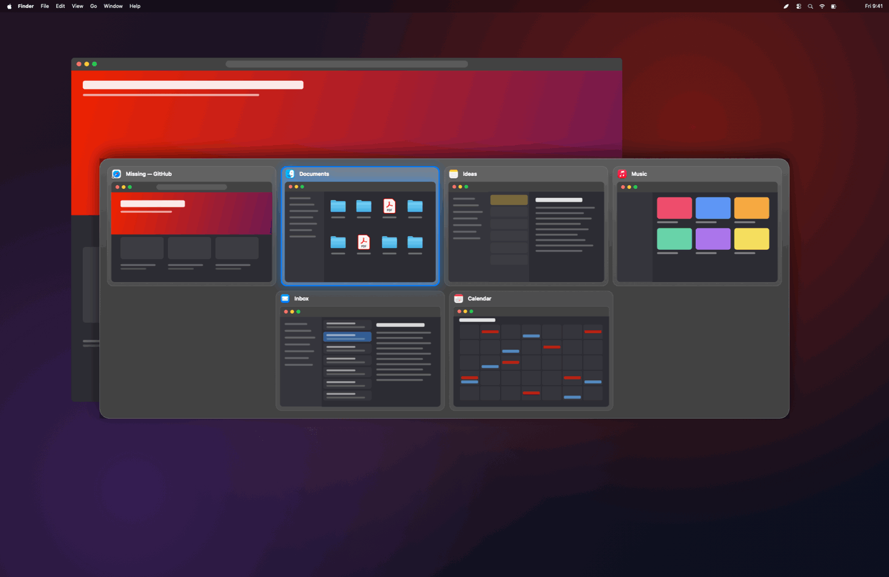

</div>

---

The Mac is great, but some everyday things are missing or only half done. ⌘Tab shows apps, not windows. Switching the sound output means a trip through menus. Splitting the screen, capturing a long page or finding a file by name each send you hunting for another app.

Missing brings these forgotten features together, and each one feels like it shipped with macOS. Turn off what you don't need: a feature you turn off never asks for a permission and never runs.

## ⌘Tab, window by window

Windows, not just apps, with live previews. Every browser profile, every Space and every full-screen window is there. Close a window with the red dot on its card, or send it to part of the screen with the button next to it.

- **⌥Tab** works too, with its own settings (previews, list view, one app only).
- **Drop a file on a card** to open it with that app. Drop it on a Finder window to move it into that folder.
- Too many windows to fit? Previews shrink first, then the panel scrolls with your selection.

## Find files in Finder, like Spotlight

<div align="center">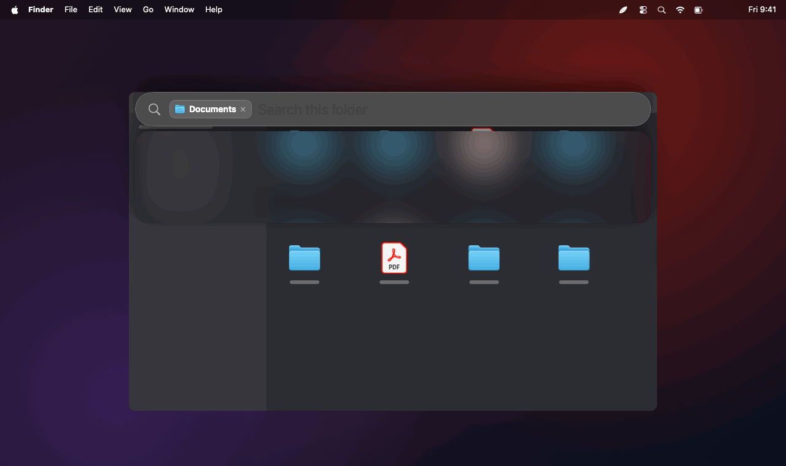</div>

Press **⌘Space while Finder is in front** and a Spotlight-style bar opens. It matches file names as you type, inside the folder you're looking at; **Tab** widens the search to the whole Mac. Results are grouped like Spotlight: Top Hit, Folders, Documents, Images and more.

The selected result is previewed on the right; hover a row to preview it. **Space** opens Quick Look just like in Finder, **⌘⌫** moves the file to the Trash right away, **Enter** opens and **⌘Enter** shows it in Finder. Typing in Finder's own search box shows the same instant results right below it. Everywhere else, ⌘Space still opens Spotlight.

## Files: Missing's own file window

<div align="center">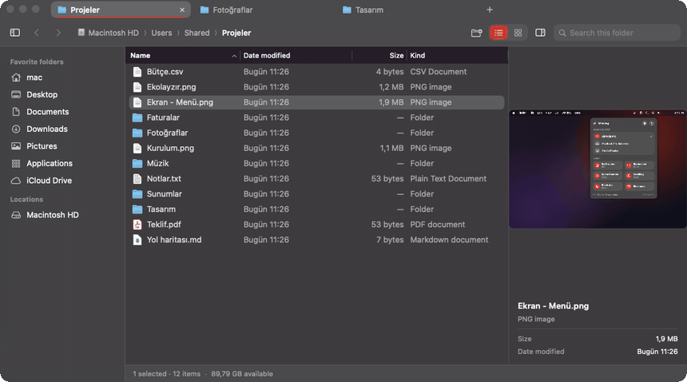</div>

A file window of its own that doesn't depend on Finder. It takes the parts people miss from Windows Explorer (typeable address bar, preview pane, real copy progress) and keeps what Finder does well (tags, column view, Quick Look). Open it from **Settings › Files**, or click Missing's icon in the Dock.

### Four themes

- **Missing:** dark glass with a red accent. Tabs start on the left like Windows.
- **Finder:** full-height sidebar, tabs under the toolbar, path bar at the bottom.
- **Windows:** Explorer-style tabs, address bar and command bar.
- **Glass:** floating frosted cards on a colorful blur.

All four follow the system's light/dark mode. The right-click menu, Get Info, dialogs and Files Settings take on the theme too. Switch themes in **View › Theme** or in Files Settings.

### Views

- **List (⌘1):** sortable columns.
- **Icons (⌘2):** real thumbnails. The slider at the bottom right, or a trackpad pinch, sets the icon size from small to large. Left and right arrows continue onto the next or previous row.
- **Columns (⌘3):** like Finder; a selected folder opens in a new column to the right.

<div align="center">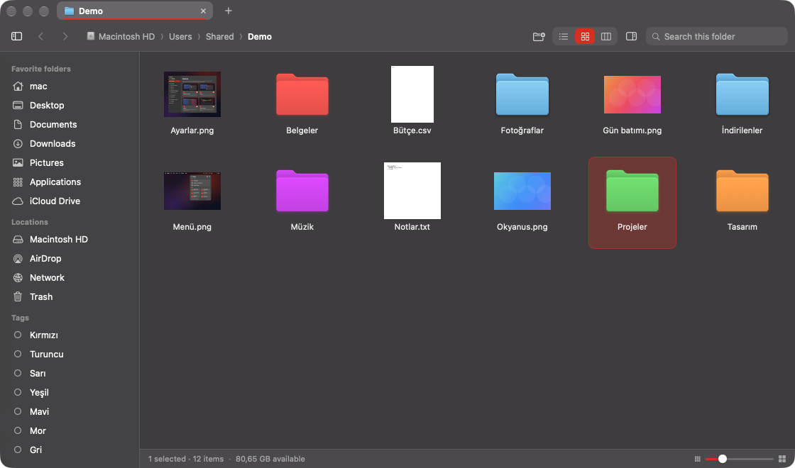</div>

**⇧⌘P** opens a preview pane on the right, like Windows Explorer: Quick Look of the selected file with its size, kind and dates. **Space** opens a larger preview.

<div align="center">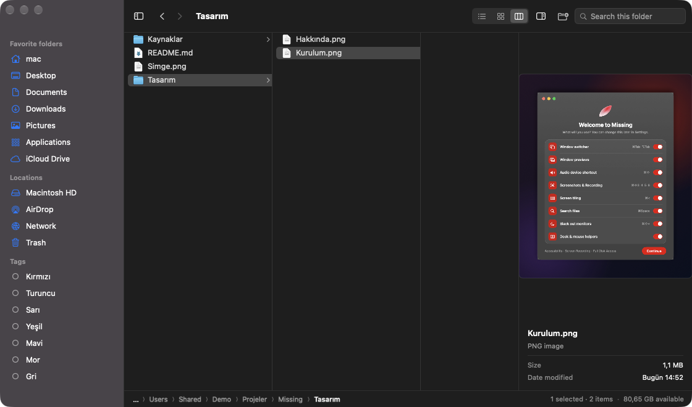</div>

### Preview (Space)

**Space** (or **⌘Y**) opens Missing's own preview window instead of Quick Look, styled like the theme.

- It shows the file's size, kind and date, with buttons to open it, share it and go to the previous or next file.
- It doesn't take focus: the arrow keys keep moving the selection, and one click on another file previews that one.
- Photos and videos fill the screen at their own proportions, and phone photos come out the right way up.
- Audio and video files get a scissors button that opens the editor.

### Audio and video editor

Cut, trim and join audio and video without another app. Click the scissors in the preview, or right-click a file › **Quick Actions › Edit…**. Each file opens in its own window, in the Files theme.

- **Timeline:** clips show thumbnails and a waveform. Zoom with the slider, a trackpad pinch or **⌘+ / ⌘−**.
- **Select a range:** drag across a clip, or press **I** and **O** at the playhead. **Delete** (**⌫**) cuts the range out; **Trim** keeps only the range.
- **Split** (**S**) cuts at the playhead. Drag a clip's edge to shorten it; drag its top strip to move it.
- **Add to start / Add to end** bring in other audio or video files. You can also drop them on the timeline from Files or Finder.
- **Space** plays and pauses, **← / →** step one frame (one second with **⇧**), **⌘Z / ⇧⌘Z** undo and redo.

**Save** (**⌘S**) gives three choices:

- **Replace the original:** the original goes to the Trash, so you can still get it back.
- **Save as a new file:** "Name (edited)" next to the original.
- **Export in another format:** MP4 (H.264 or HEVC), MOV, M4A, WAV, AIFF or CAF, in the folder you pick.

When the clips stay in their own format, the result is written without re-encoding, so the quality doesn't change. Files Missing can't write back, like MP3 or FLAC, can still be edited; they're saved as M4A or WAV, and videos as MP4.

### Tabs and the address bar

**⌘T** opens a new tab. Drag tabs to reorder them; close one with a middle-click or **⌘W**. Drop files on a tab to move them into that folder. The last window's tabs come back next time.

Click the path at the top, or press **⌘L**, and it becomes a typeable address like in Windows. Type a folder and press Enter to go there; type a file path and the file gets selected. Right-click any part of the path for **Copy Path**, **Edit Path** or **Open in New Tab**. **⇧⌘G** goes to a folder, **⌘[ / ⌘]** go back and forward, and **⌘↑** goes to the enclosing folder. Mouse side buttons go back and forward too.

<div align="center">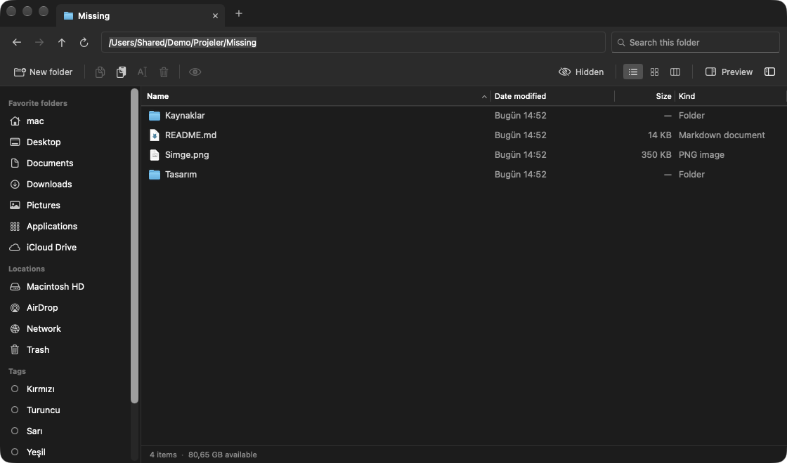</div>

### Tab switcher (⌘")

Hold **⌘** and press **"** (**`** on US keyboards) and your tabs open as cards in the exact center of the window, styled like Missing's ⌘Tab. Each press moves to the next tab and **⇧** goes back; release ⌘ to switch. **Esc** cancels and a click picks a card. A slim favorites column on the right opens a folder in a new tab in the same window.

<div align="center">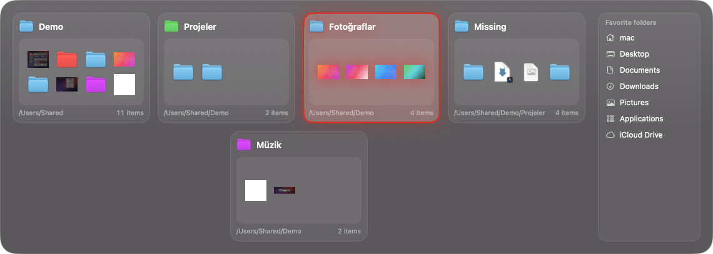</div>

In **Settings › Files › Tab switcher** you can switch to a list like ⌘Tab's list view, hide the folder contents on the cards, or turn the favorites column off.

<div align="center">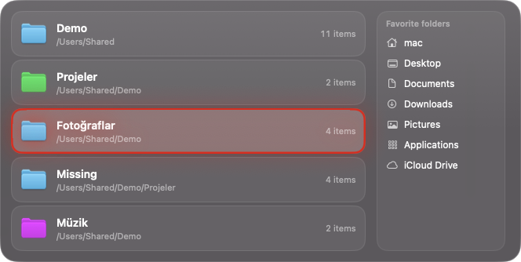</div>

### Sidebar

- **Favorites:** kept in sync with Finder's sidebar both ways. Add a folder here and it appears in Finder, and the other way around.
- **Locations:** your disks (with an eject button), cloud folders like iCloud Drive, Google Drive, OneDrive and Dropbox, your home folder, AirDrop, Network and Trash.
- **Tags:** Finder's tags with their colors. Click one to list every file carrying that tag.
- **Recents, Trash and Network** open inside Files. Empty the Trash from its page; the Network page finds computers sharing files and has **Connect to Server**.

Right-click an item › **Hide from Sidebar**, or pick what shows in **Files Settings (⌘,)**. Drag a heading to reorder the sections, or right-click it › **Move up** / **Move down**. **Settings › Files › Sidebar layout** edits the headings, their order and their folders too.

### Colors and new folders

**⇧⌘N** opens a small New Folder sheet: type the name, pick a color and press Enter. Right-click any file or folder for Finder's color dots. A color is a Finder tag, so it shows up in Finder too, and colored folders are tinted that color, like in macOS Tahoe.

<div align="center">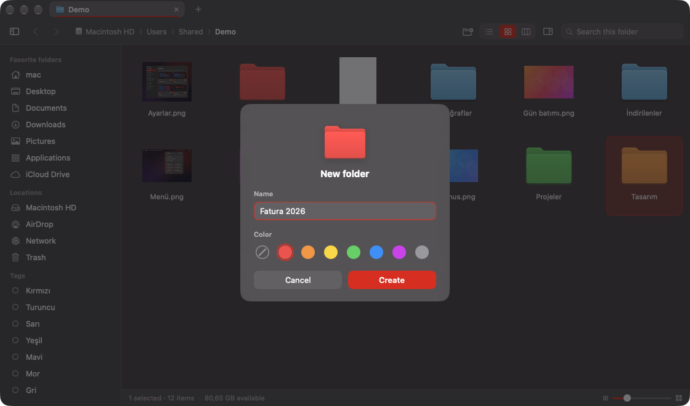</div>

### Copying and moving

Drag between folders, tabs, the sidebar and other apps. Dropping on the same disk moves; dropping on another disk copies (hold **⌥** to always copy). **⌘C / ⌘V** copy, and **⌥⌘V** moves the copied items here.

While you drag, a folder under the pointer opens its lid and takes on the theme's color. Hold over it for a moment and it opens, so you can drop deeper.

A card at the bottom right shows each copy as it runs: how much is done, how much is left and the time remaining. The **×** cancels it and removes the half-copied file. The status bar shows the total.

<div align="center">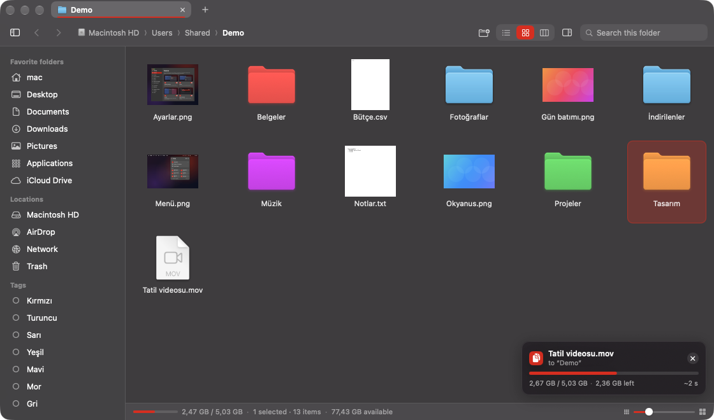</div>

### Search

The search box (**⌘F**) filters the current folder instantly, then looks through every subfolder with the same index as ⌘Space search. Results in subfolders show where they are, and the ones you open often move up.

### Everyday keys

**Return** renames, **⌘D** duplicates, **⌘⌫** moves to the Trash and **⌘Z** undoes it all. **⌥⌘C** copies the path and **⇧⌘.** shows hidden files. Right-click for Open With, Share, Copy Path and Open in Terminal.

Type the first letters of a name to select it, in icon and list views. A single click works even while another app is in front.

### Right-click menu

Files has its own right-click menu, with icons, shortcuts and submenus that open to the side.

- **Quick Actions** by file type: rotate, convert or resize images, make a PDF from images, combine PDFs, convert or shrink videos, extract or convert audio, and **Edit…** for audio and video.
- **Get Info (⌘I)**, **Compress** / **Extract Here**, **Make Alias**, **Show Package Contents**, and iCloud **Download Now** / **Remove Download**.
- **Share** opens AirDrop, Mail, Messages and the other services in a menu styled like the theme.

### In the Dock

While a Files window is open, Missing shows in the Dock with a blue folder icon, like Finder. Click **Add to Dock** in Settings, or right-click the icon › Options › **Keep in Dock**, and a click on the icon opens the window any time. Right-click it for **Recent Folders**.

Two options in **Settings › Files**, both off at first: **Finder in the Dock** makes a click on Finder's Dock icon open Files (hold ⌥ for the real Finder), and **Files instead of Finder** opens "Show in Finder" from other apps, and folders on the desktop, in Files.

## Split the screen from the notch

<div align="center">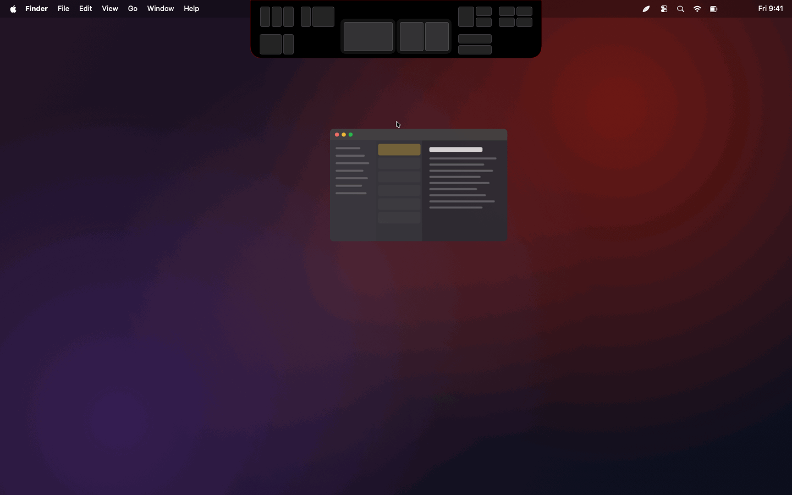</div>

Drag a window to the top of the screen. On MacBooks with a notch, the notch grows into an island with layouts on both sides. Your two most-used layouts sit right under the notch and update as you use them. Drop the window on a zone and it snaps there. Or press **⌘<** to pick a layout: fill it window by window, or let Missing fill the zones with the most recently used windows on that screen (Settings › Screen).

## One key for sound output

<div align="center">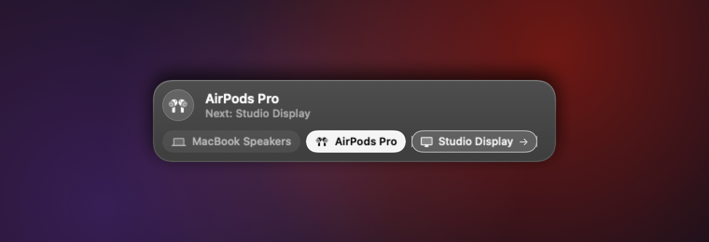</div>

Hold **⌘** and tap **⇧** to move to the next output: speakers → AirPods → display. Assign a device per app, and sound follows when that app comes forward.

## A simple equalizer

<div align="center">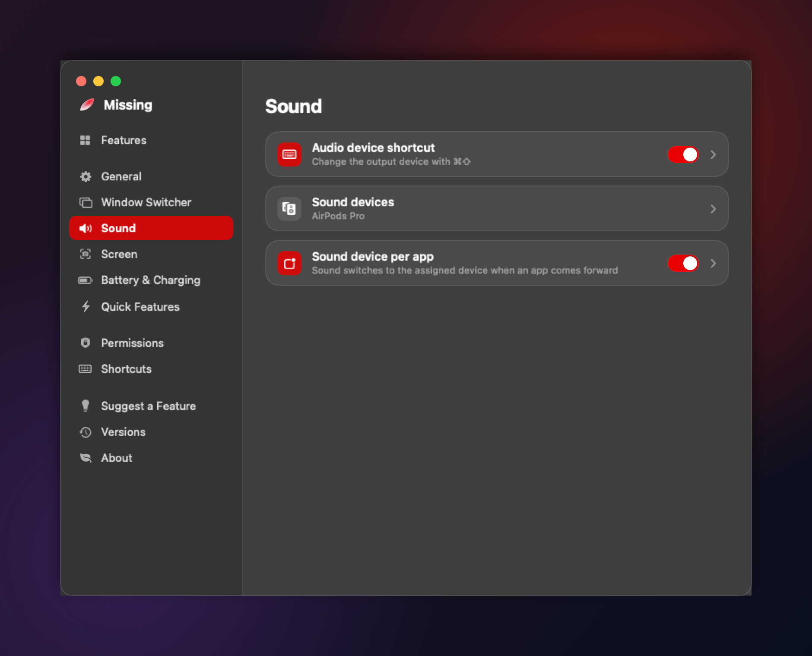</div>

Ten bands from 32 Hz to 16 kHz (±12 dB) and a preamp for all system audio, with presets (Flat, Bass, Treble, Voice, Night). Missing uses macOS's own audio tap (macOS 14.2+): no driver, no extra app. It follows you when you switch output devices, and the first time macOS asks once for audio recording permission. Nothing is recorded.

### Volume leveler

Raises quiet sound and lowers loud sound, so everything from the Mac plays at the **Target level** you pick. Silence and pauses between sentences aren't boosted, and sudden loud sounds are lowered without clipping. Turn it on in **Settings › Quick Features** or in the menu bar panel; it uses the same audio path as the equalizer.

## Mouse, without LinearMouse or Mos

<div align="center">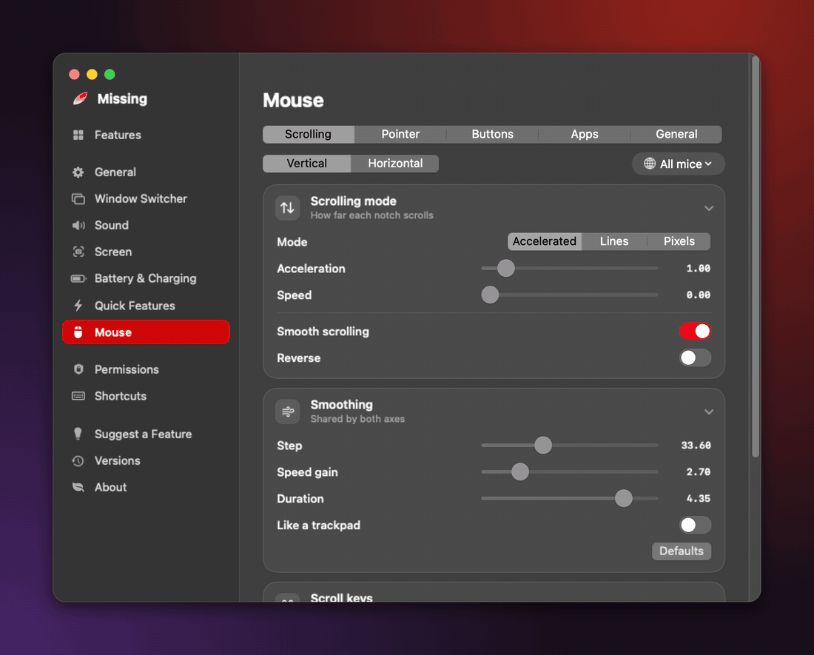</div>

Open **Settings › Mouse**. Smooth scrolling that feels like Mos (step, speed gain, duration, trackpad-style), scrolling modes from LinearMouse (accelerated, by lines, by pixels) that can be smoothed too, and keys that speed up, switch direction or turn off smoothing while held.

- **Pointer:** turn off acceleration, or set acceleration and speed separately. When Missing quits or crashes, the pointer goes back to the system setting.
- **Buttons:** universal back/forward, switch left and right, click debouncing, middle-button autoscroll, gestures, and mappings from any button or shortcut to an action (Mission Control, Spaces, screenshots, media keys, open an app or file, run a command).
- **Per device, display and app:** each setting can apply to all mice, one mouse, one display or one app. Trackpads and the Magic Mouse are left alone.
- **Import** your LinearMouse or Mos settings.

## Battery and charging profiles

*Only on the 14-inch MacBook Pro with M4 Pro; on every other Mac this doesn't appear at all.*

Unplug and the display drops to the **600-nit** preset at **60 Hz** with **Low Power Mode**. Plug back in and it returns to **1600 nits (XDR)**, **ProMotion** and **High Power Mode**. It happens automatically, or switch by hand from the menu bar.

## Keep awake

Stop the display from turning off and the Mac from sleeping: **indefinitely**, or for **15 minutes to 5 hours**. Pick one in the menu bar panel: a duration, or **for as long as an app you pick stays open** (choose it from the list); press it again to turn it off. **⌘⇧<** toggles it too. While it's on, the menu bar icon becomes a cup and the time left sits under the notch.

- **Display or just the Mac:** keep the display on, or let it turn off while the Mac keeps working on a download or a long job.
- **Automatic:** only while charging, turn off when the battery gets low, start when Missing opens.
- **Safe in a bag:** closing the lid still puts the Mac to sleep, and keep awake turns itself off instead of resuming later. No administrator password needed.
- **Lid closed, if you want it:** an optional setting keeps the Mac working with the lid closed (asks for your administrator password once). It still sleeps as soon as you unplug it, disconnect the external display, hit the time limit or run low on battery.

## Everything else, one click away

<div align="center">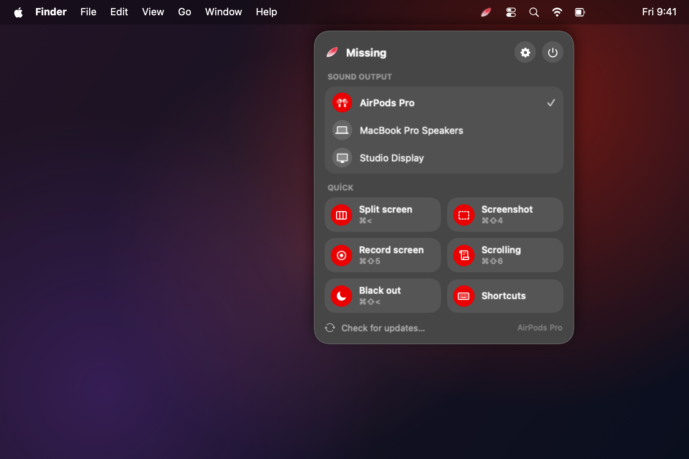</div>

Click the leaf in the menu bar for a glass panel: sound output at the top, then quick actions (split screen, screenshot, record, scrolling capture) and brightness sliders for external displays.

- **Screenshots and recording:** ⌘⇧3 captures the display you're on, ⌘⇧4 an area, ⌘⇧6 a whole scrolling page, ⌘⇧5 records MP4. Capture or record **just one window** from the ⌘⇧5 palette, with its own save folder.
- **Quick features:** equalizer, volume leveler, the Files window, grouped ⌘Tab view, back/forward with mouse buttons in Finder, instant Dock opening while dragging a file.

## Only what you use

<div align="center">
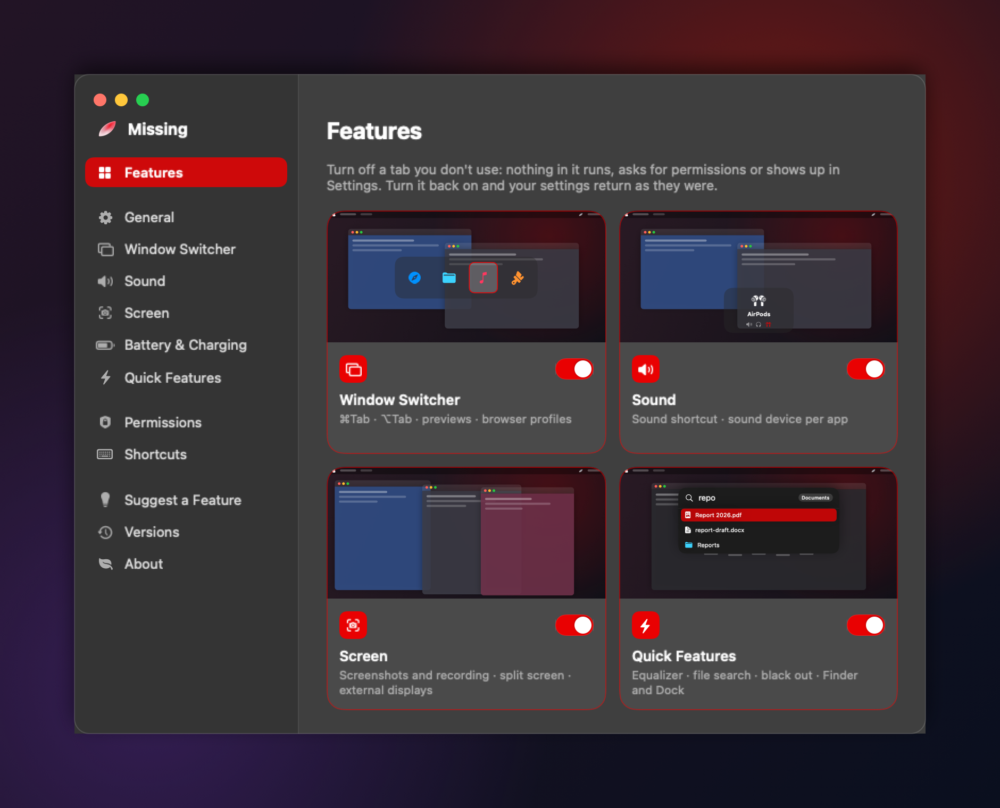
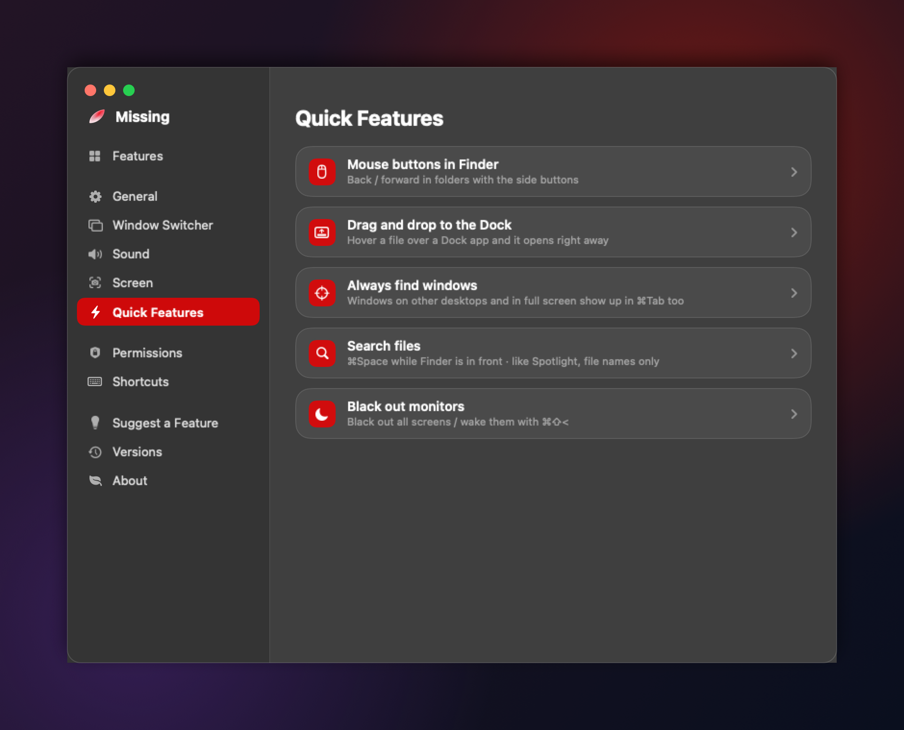
</div>

**Settings › Features** turns whole tabs on or off: Window Switcher, Sound, Screen and Quick Features, each with a live preview. A tab you turn off disappears completely: from the sidebar, the menu bar panel, the shortcut list and the permissions page. Nothing in it runs or asks for a permission. Turn it back on and your settings come back as they were. Inside each tab, every option still has its own switch.

## Shortcuts

<div align="center">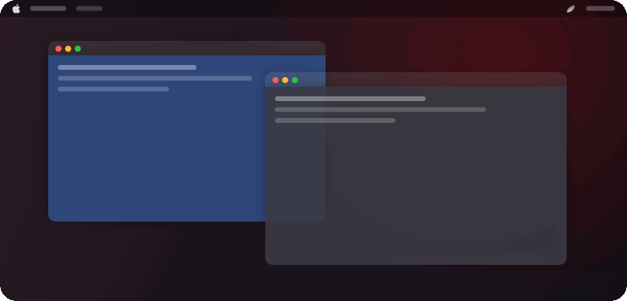</div>

**Settings › Shortcuts** plays a short animation of what each shortcut does.

| Shortcut | Does |
|---|---|
| ⌘Tab / ⌥Tab | Switch windows (⌥Tab with previews) |
| ⌘⇧ (tap ⇧) | Next sound output |
| ⌘< | Split screen |
| ⌘⇧< | Keep awake on / off |
| ⌘⇧3 · ⌘⇧4 · ⌘⇧5 · ⌘⇧6 | Display · area · record · scrolling capture |
| ⌘Space (in Finder) | Find files |
| ⌘" (in Files; ⌘` on US keyboards) | Switch tabs |
| Space (in Files) | Preview |
| Space · S · I / O · ⌫ · ⌘S (in the editor) | Play · split · range start / end · cut · save |

## Missing something?

Is there a feature the Mac forgot, skipped or only half did? **[Suggest it here](https://github.com/firewallstudio/Missing/issues/new?template=feature_request.yml)** and give a 👍 to [ideas](https://github.com/firewallstudio/Missing/issues?q=label%3Aidea) you'd like too. The most wanted ones come first. You can also open the form from **Settings › Suggest a Feature** in the app.

## Install

```bash
curl -fsSL https://raw.githubusercontent.com/firewallstudio/Missing/main/install.sh | bash
```

Or download `Missing.zip` from [Releases](https://github.com/firewallstudio/Missing/releases/latest) and drag `Missing.app` into **Applications**.

<div align="center">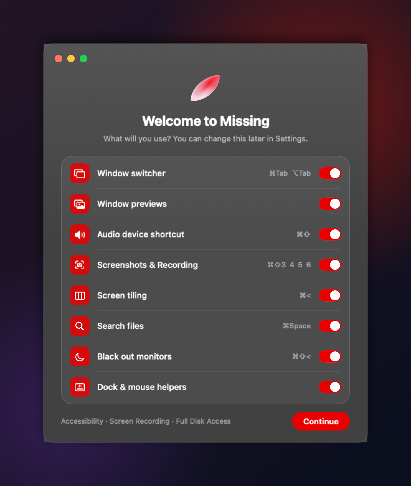</div>

On first launch Missing asks which features you want and only requests the permissions those need. You can change everything later in **Settings**.

Missing isn't in Apple's paid developer program. If you downloaded the zip in a browser and macOS blocks it, open **System Settings › Privacy & Security** and click **Open Anyway**, or run `xattr -dr com.apple.quarantine /Applications/Missing.app`.

## Privacy

Nothing leaves your Mac. The only network request is the update check against GitHub Releases. File search keeps an index of file names on this Mac only; file contents are never read.

## Build

```bash
./build.sh             # build Missing.app for this Mac
./build.sh --install   # build and install to /Applications
./release.sh           # sign and publish the version in VERSION (needs the Missing Code Signing key)
```

Every release is signed with the same certificate (`signing/Missing.pem`, "Missing Code Signing"), so macOS keeps your permissions across updates, and the updater only installs builds signed with it. Versions up to 4.3.22 were signed with `signing/AudioTab.pem`; moving from those to 4.3.23 or later needs one manual download, and macOS asks for Missing's permissions again once.

<sub>The images show Missing's real interface; window contents in the backgrounds are illustrations.</sub>
