<div align="center">

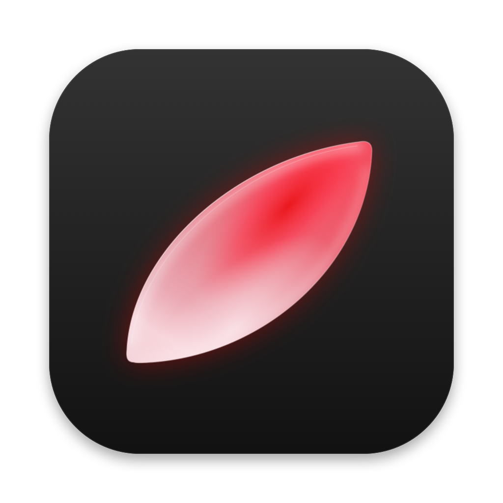

# Missing

**The features your Mac left out, in one light menu bar app.**

[**Download**](https://github.com/firewallstudio/Missing/releases/latest) · [▶ Video](design/Missing-promo.mp4) · [Install](#install) · [Shortcuts](#shortcuts) · [Suggest a feature](https://github.com/firewallstudio/Missing/issues/new?template=feature_request.yml) · [**Türkçe**](README.tr.md)

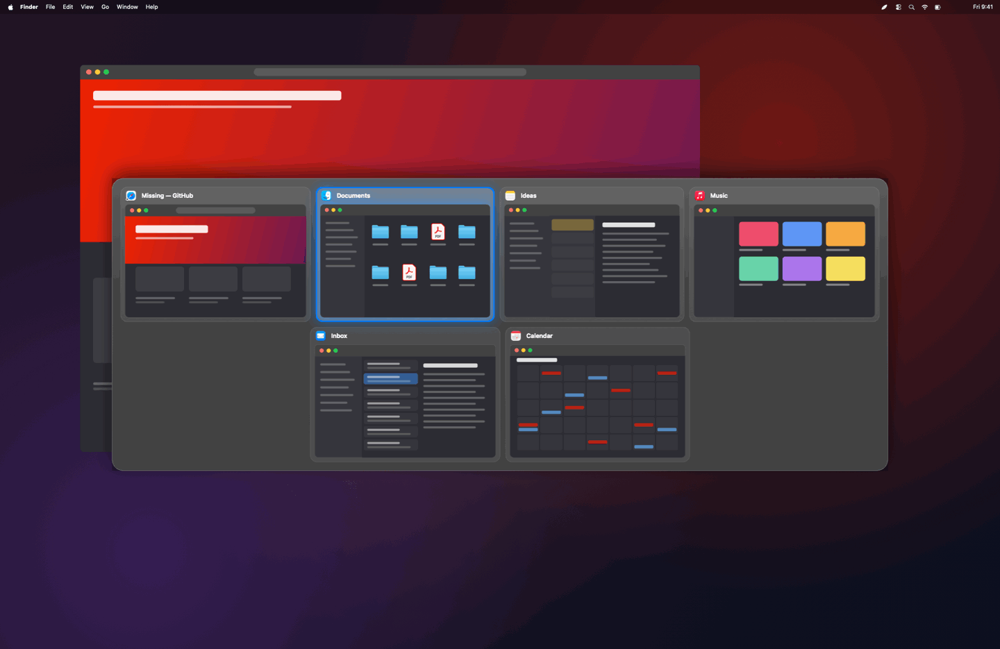

</div>

---

The Mac is great, but some everyday things are missing or only half done. ⌘Tab shows apps, not windows. Switching the sound output means a trip through menus. Splitting the screen, capturing a long page or finding a file by name each send you hunting for another app.

Missing brings these forgotten features together, and each one feels like it shipped with macOS. Turn off what you don't need: a feature you turn off never asks for a permission and never runs.

## ⌘Tab, window by window

Windows, not just apps, with live previews. Every browser profile, every Space and every full-screen window is there. Close a window with the red dot on its card, or send it to part of the screen with the button next to it.

- **⌥Tab** works too, with its own settings (previews, list view, one app only).
- **Drop a file on a card** to open it with that app. Drop it on a Finder window to move it into that folder.
- Too many windows to fit? Previews shrink first, then the panel scrolls with your selection.

## Find files in Finder, like Spotlight

<div align="center">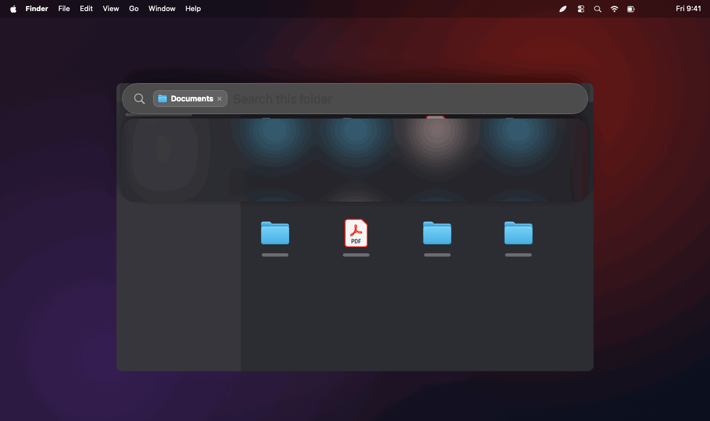</div>

Press **⌘Space while Finder is in front** and a Spotlight-style bar opens. It matches file names as you type, inside the folder you're looking at; **Tab** widens the search to the whole Mac. Results are grouped like Spotlight: Top Hit, Folders, Documents, Images and more.

The selected result is previewed on the right; hover a row to preview it. **Space** opens Quick Look just like in Finder, **⌘⌫** moves the file to the Trash right away, **Enter** opens and **⌘Enter** shows it in Finder. Typing in Finder's own search box shows the same instant results right below it. Everywhere else, ⌘Space still opens Spotlight.

## Finder tabs, like Windows

<div align="center"></div>

Finder stretches its tabs across the whole window, even when there are only two. Missing lays them out like Windows: from the left, each one up to a set width, shrinking as you open more and scrolling when they don't fit. Hover a tab to close it, click **+** for a new one. It blends into Finder's own bar and stays put when you switch apps or right-click.

## Split the screen from the notch

<div align="center">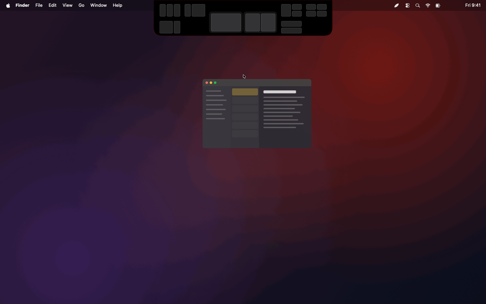</div>

Drag a window to the top of the screen. On MacBooks with a notch, the notch grows into an island with layouts on both sides. Your two most-used layouts sit right under the notch and update as you use them. Drop the window on a zone and it snaps there. Or press **⌘<** to pick a layout: fill it window by window, or let Missing fill the zones with the most recently used windows on that screen (Settings › Screen).

## One key for sound output

<div align="center">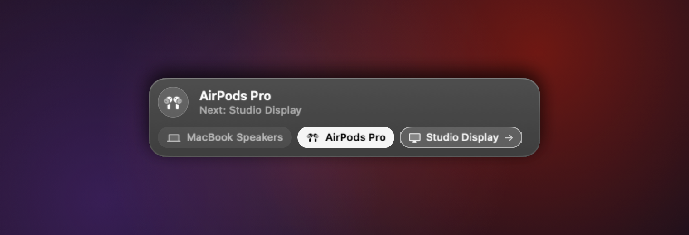</div>

Hold **⌘** and tap **⇧** to move to the next output: speakers → AirPods → display. Assign a device per app, and sound follows when that app comes forward.

## A simple equalizer

<div align="center">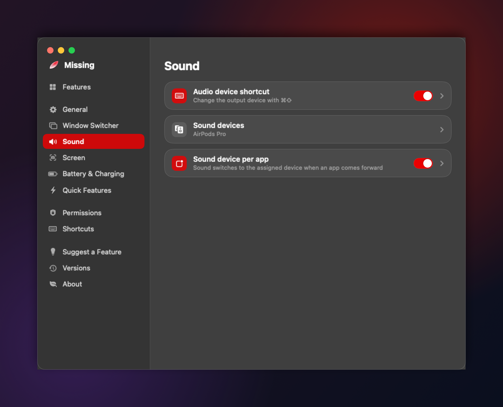</div>

Ten bands from 32 Hz to 16 kHz (±12 dB) and a preamp for all system audio, with presets (Flat, Bass, Treble, Voice, Night). Missing uses macOS's own audio tap (macOS 14.2+): no driver, no extra app. It follows you when you switch output devices, and the first time macOS asks once for audio recording permission. Nothing is recorded.

## Mouse, without LinearMouse or Mos

Open **Mouse** from the menu bar panel. Smooth scrolling that feels like Mos (step, speed gain, duration, trackpad-style), scrolling modes from LinearMouse (accelerated, by lines, by pixels) that can be smoothed too, and keys that speed up, switch direction or turn off smoothing while held.

- **Pointer:** turn off acceleration, or set acceleration and speed separately. When Missing quits or crashes, the pointer goes back to the system setting.
- **Buttons:** universal back/forward, switch left and right, click debouncing, middle-button autoscroll, gestures, and mappings from any button or shortcut to an action (Mission Control, Spaces, screenshots, media keys, open an app or file, run a command).
- **Per device, display and app:** each setting can apply to all mice, one mouse, one display or one app. Trackpads and the Magic Mouse are left alone.
- **Import** your LinearMouse or Mos settings.

## Battery and charging profiles

*Only on the 14-inch MacBook Pro with M4 Pro; on every other Mac this doesn't appear at all.*

Unplug and the display drops to the **600-nit** preset at **60 Hz** with **Low Power Mode**. Plug back in and it returns to **1600 nits (XDR)**, **ProMotion** and **High Power Mode**. It happens automatically, or switch by hand from the menu bar.

## Everything else, one click away

<div align="center">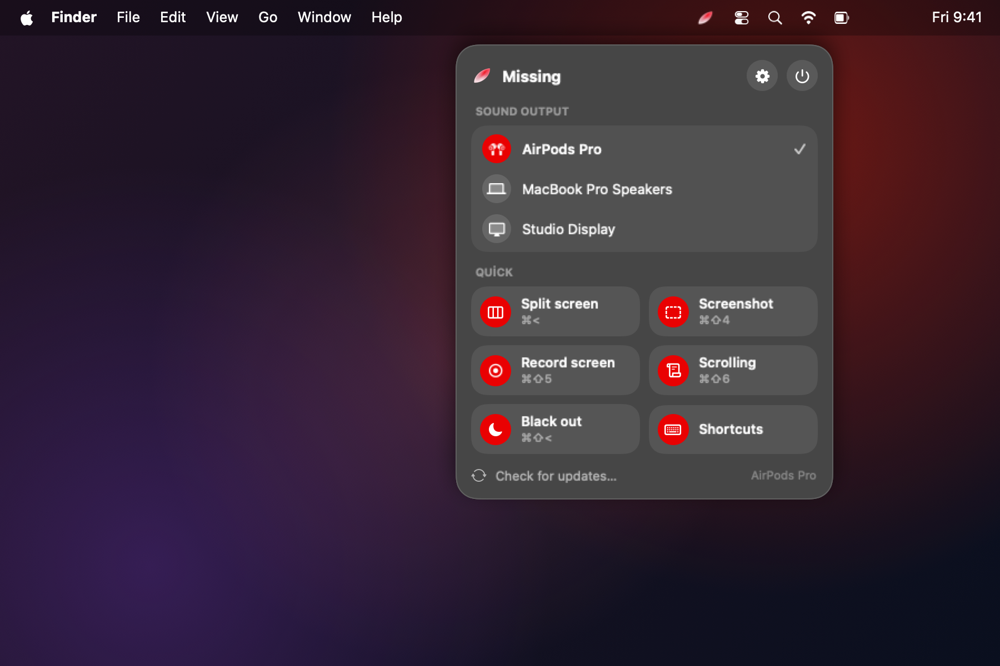</div>

Click the leaf in the menu bar for a glass panel: sound output at the top, then quick actions (split screen, screenshot, record, scrolling capture, black out displays) and brightness sliders for external displays.

- **Screenshots and recording:** ⌘⇧3 captures the display you're on, ⌘⇧4 an area, ⌘⇧6 a whole scrolling page, ⌘⇧5 records MP4. Capture or record **just one window** from the ⌘⇧5 palette, with its own save folder.
- **Black out displays** with ⌘⇧<, and bring them back the same way.
- **Quick features:** equalizer, Windows-style Finder tabs, grouped ⌘Tab view, back/forward with mouse buttons in Finder, instant Dock opening while dragging a file.

## Only what you use

<div align="center">
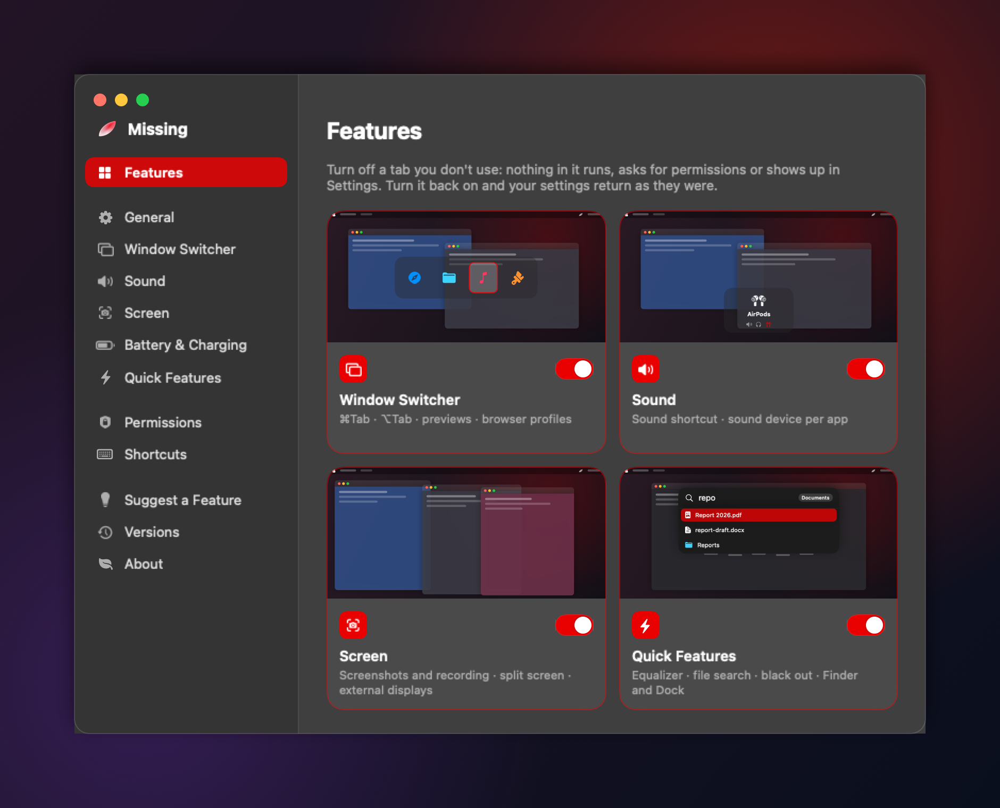
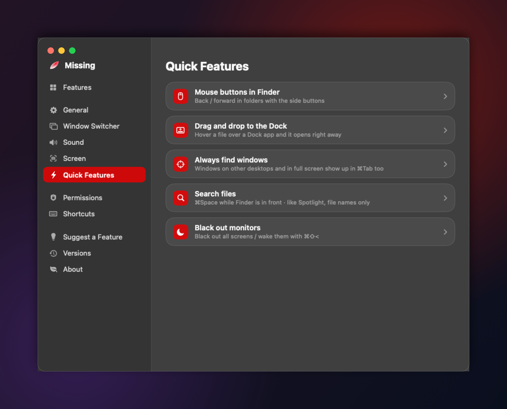
</div>

**Settings › Features** turns whole tabs on or off: Window Switcher, Sound, Screen and Quick Features, each with a live preview. A tab you turn off disappears completely: from the sidebar, the menu bar panel, the shortcut list and the permissions page. Nothing in it runs or asks for a permission. Turn it back on and your settings come back as they were. Inside each tab, every option still has its own switch.

## Shortcuts

<div align="center">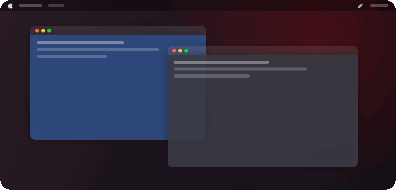</div>

**Settings › Shortcuts** plays a short animation of what each shortcut does.

| Shortcut | Does |
|---|---|
| ⌘Tab / ⌥Tab | Switch windows (⌥Tab with previews) |
| ⌘⇧ (tap ⇧) | Next sound output |
| ⌘< | Split screen |
| ⌘⇧3 · ⌘⇧4 · ⌘⇧5 · ⌘⇧6 | Display · area · record · scrolling capture |
| ⌘Space (in Finder) | Find files |
| ⌘⇧< | Black out displays |

## Missing something?

Is there a feature the Mac forgot, skipped or only half did? **[Suggest it here](https://github.com/firewallstudio/Missing/issues/new?template=feature_request.yml)** and give a 👍 to [ideas](https://github.com/firewallstudio/Missing/issues?q=label%3Aidea) you'd like too. The most wanted ones come first. You can also open the form from **Settings › Suggest a Feature** in the app.

## Install

```bash
curl -fsSL https://raw.githubusercontent.com/firewallstudio/Missing/main/install.sh | bash
```

Or download `Missing.zip` from [Releases](https://github.com/firewallstudio/Missing/releases/latest) and drag `Missing.app` into **Applications**.

<div align="center">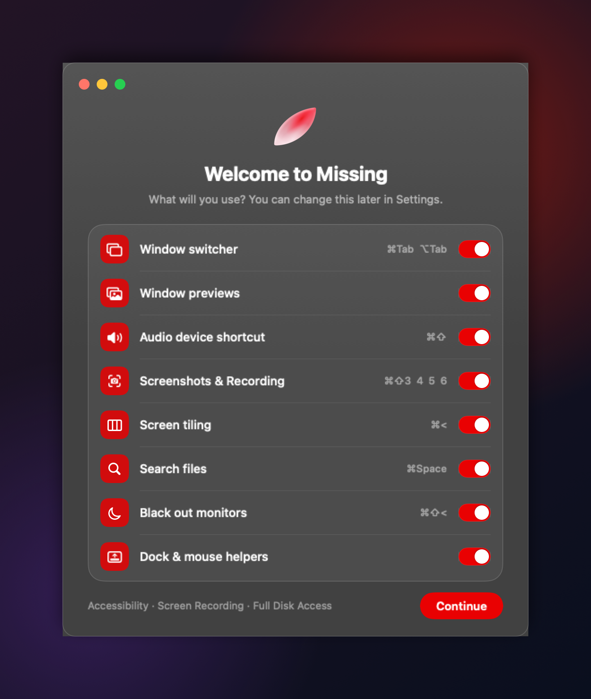</div>

On first launch Missing asks which features you want and only requests the permissions those need. You can change everything later in **Settings**.

Missing isn't in Apple's paid developer program. If you downloaded the zip in a browser and macOS blocks it, open **System Settings › Privacy & Security** and click **Open Anyway**, or run `xattr -dr com.apple.quarantine /Applications/Missing.app`.

## Privacy

Nothing leaves your Mac. The only network request is the update check against GitHub Releases. File search keeps an index of file names on this Mac only; file contents are never read.

## Build

```bash
./build.sh             # build Missing.app for this Mac
./build.sh --install   # build and install to /Applications
```

Every release is signed with the same certificate (`signing/AudioTab.pem`), so macOS keeps your permissions across updates, and the updater only installs builds signed with it.

<sub>The images show Missing's real interface; window contents in the backgrounds are illustrations.</sub>
