<div align="center">

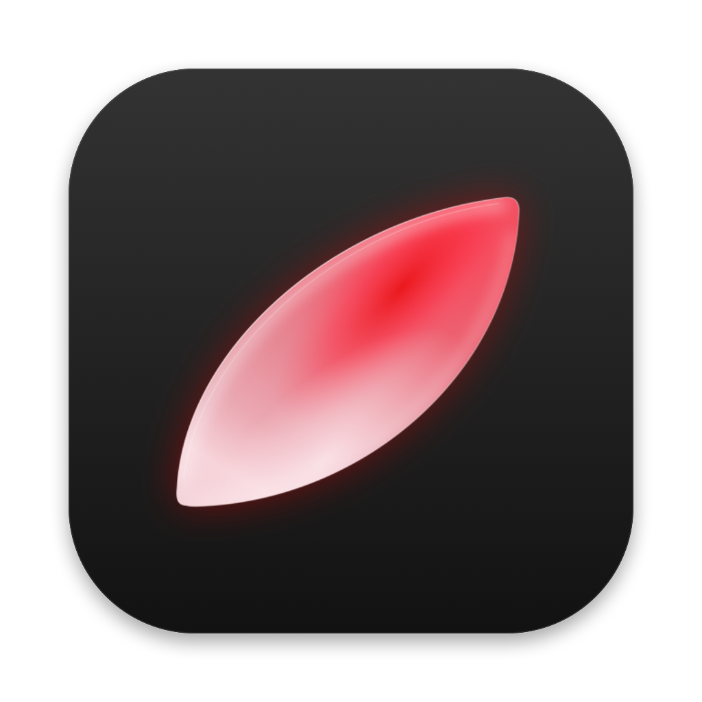

# Missing

**Mac'te eksik kalan özellikler, menü çubuğunda tek hafif bir uygulamada.**

[**İndir**](https://github.com/firewallstudio/Missing/releases/latest) · [▶ Video](design/Missing-promo.mp4) · [Kurulum](#kurulum) · [Kısayollar](#kısayollar) · [Özellik öner](https://github.com/firewallstudio/Missing/issues/new?template=feature_request.yml) · [**English**](README.md)

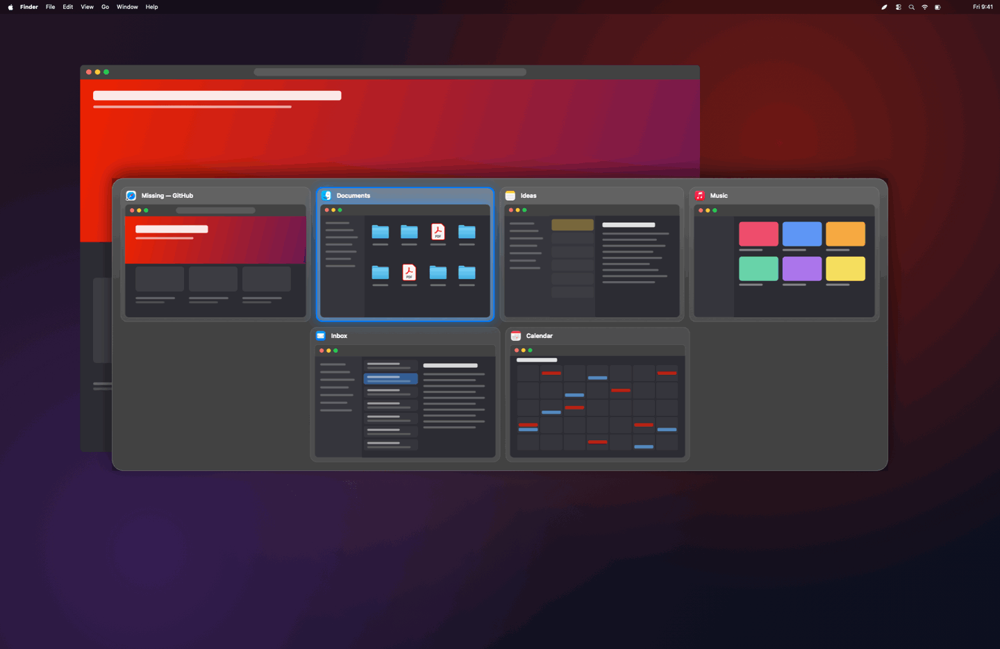

</div>

---

Mac harika, ama her gün kullandığımız bazı şeyler ya hiç yok ya da yarım bırakılmış. ⌘Tab pencereleri değil uygulamaları gösterir. Ses çıkışını değiştirmek menülerde dolaşmak ister. Ekranı bölmek, uzun bir sayfanın görüntüsünü almak ya da bir dosyayı adından bulmak için ayrı ayrı uygulama aramak gerekir.

Missing unutulmuş bu özellikleri bir araya getirir; her biri macOS'la birlikte gelmiş gibi davranır. İstemediğini kapatırsın: kapattığın özellik ne izin ister ne de çalışır.

## Pencere pencere ⌘Tab

Uygulamalar değil pencereler, canlı önizlemeyle. Tüm tarayıcı profilleri, diğer masaüstleri ve tam ekran pencereler dahil. Kartın kırmızı noktasıyla pencereyi kapatır, yanındaki düğmeyle ekranın bir bölümüne gönderirsin.

- **⌥Tab** da var, kendi ayarlarıyla (önizleme, liste görünümü, tek uygulama).
- **Kartın üstüne dosya bırak**, o uygulamayla açılsın. Finder penceresine bırakırsan dosya o klasöre gider.
- Pencereler sığmazsa önce önizlemeler küçülür, sonra panel seçimi takip ederek kayar.

## Finder'da Spotlight gibi dosya arama

<div align="center">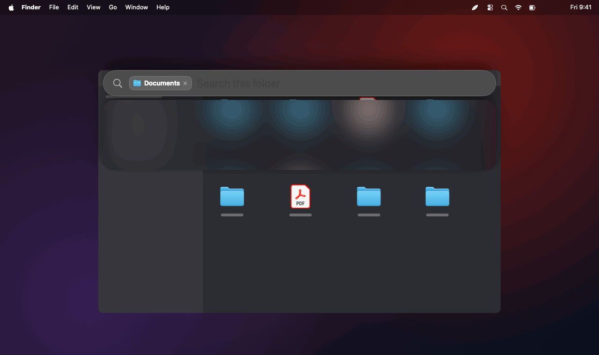</div>

**Finder öndeyken ⌘Space**'e bas: Spotlight tarzı bir çubuk açılır. Yazdıkça baktığın klasörün içinde dosya adlarını süzer; **Tab** ile tüm Mac'e geçer. Sonuçlar Spotlight gibi gruplanır: En İyi Sonuç, Klasörler, Belgeler, Görüntüler…

Seçili sonuç sağda önizlenir; fareyle bir satırın üstüne gelince o önizlenir. **Space** Finder'daki gibi Hızlı Bakış açar, **⌘⌫** dosyayı anında Çöp Sepeti'ne atar, **Enter** açar, **⌘Enter** Finder'da gösterir. Finder'ın kendi arama kutusuna yazınca da kutunun altında aynı anında sonuçlar çıkar. Başka her yerde ⌘Space yine Spotlight'ı açar.

## Dosyalar: Missing'in kendi dosya penceresi

<div align="center">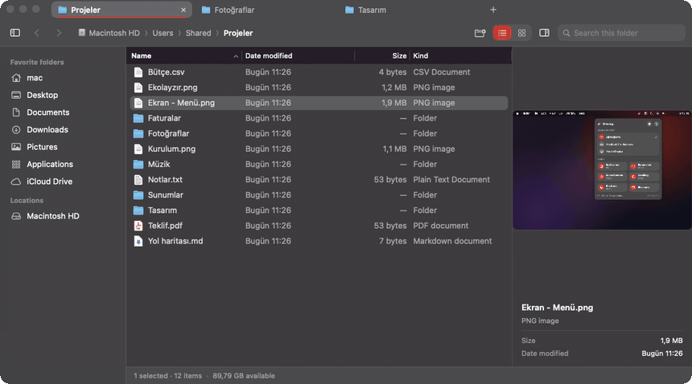</div>

Finder'a bağlı olmayan kendi dosya penceresi. Windows Gezgini'nden özlenenleri getirir: yazılabilir adres çubuğu, önizleme bölmesi, gerçek kopyalama ilerlemesi. Finder'ın iyi yaptıklarını da korur: etiketler, sütun görünümü, Hızlı Bakış. **Ayarlar › Dosyalar**'dan ya da Dock'taki Missing simgesine tıklayarak açılır.

### Dört tema

- **Missing:** koyu cam, kırmızı vurgu. Sekmeler Windows'taki gibi soldan dizilir.
- **Finder:** tam boy kenar çubuğu, araç çubuğunun altında sekmeler, altta yol çubuğu.
- **Windows:** Gezgin tarzı sekmeler, adres ve komut çubuğu.
- **Cam:** renkli bulanık zemin üstünde yüzen buzlu kartlar.

Dört tema da sistemin açık/koyu ayarını izler. Sağ tık menüsü, Bilgi al, iletişim pencereleri ve Dosyalar Ayarları da temaya uyar. Tema **Görünüm › Tema**'dan ya da Dosyalar Ayarları'ndan değişir.

### Görünümler

- **Liste (⌘1):** sıralanabilir sütunlar.
- **Simgeler (⌘2):** gerçek küçük resimler. Sağ alttaki kaydırıcı ya da izleme dörtgeninde kıstırma simgeleri küçültüp büyütür. Sağ / sol oklar satır bitince alt / üst satıra geçer.
- **Sütunlar (⌘3):** Finder'daki gibi; seçilen klasörün içi sağında yeni bir sütunda açılır.

<div align="center">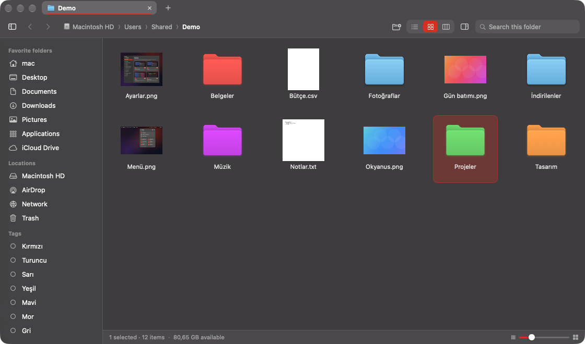</div>

**⇧⌘P** sağda Windows Gezgini'ndeki gibi bir önizleme bölmesi açar: seçili dosyanın Hızlı Bakış'ı, boyutu, türü ve tarihleri. **Space** daha büyük bir önizleme açar.

<div align="center">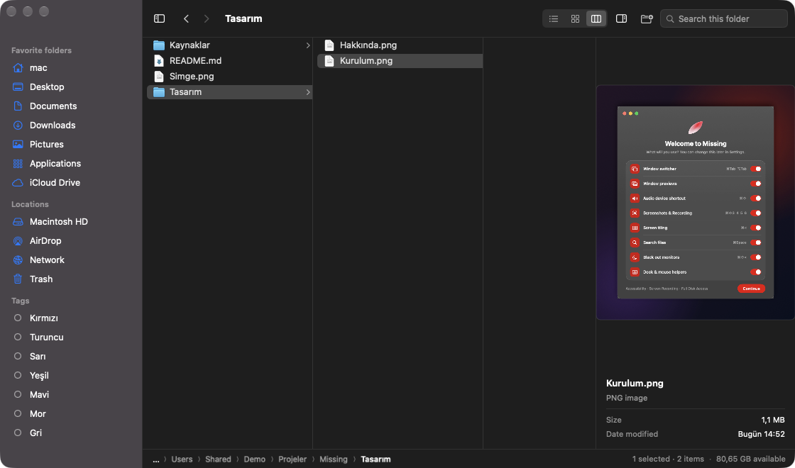</div>

### Önizleme (Space)

**Space** (ya da **⌘Y**) Hızlı Bakış yerine Missing'in kendi önizleme penceresini açar; görünüşü temaya uyar.

- Dosyanın boyutunu, türünü ve tarihini gösterir; açma, paylaşma ve önceki / sonraki dosyaya geçme düğmeleri var.
- Odağı almaz: ok tuşları seçimi oynatmaya devam eder, başka bir dosyaya tek tıklayınca onu önizler.
- Fotoğraf ve videolar kendi oranlarında ekranı doldurur; telefon fotoğrafları doğru yönde açılır.
- Ses ve video dosyalarında editörü açan bir makas düğmesi çıkar.
- Fotoğraflarda işaretlemek için bir kalem düğmesi çıkar.

### Fotoğraf işaretleme

Önizlemenin üst şeridindeki kaleme tıkla, fotoğrafın üstüne olduğu yerde çiz. Üst şerit, temanın görünümünde küçük bir araç çubuğuna dönüşür.

- **Araçlar:** seç / taşı, kalem, fosforlu kalem, ok, dikdörtgen, elips ve yazı (tıkla, yaz, **Return**). Yedi renk, üç kalınlık; yazıda kalınlık boyutu belirler. Bir işaret seçiliyken renk ve kalınlık onu değiştirir.
- **Tuşlar:** **⌘Z / ⇧⌘Z** geri alır ve yineler, **⌫** seçili işareti siler, yazıya çift tıklayınca yeniden düzenlenir. **⇧** basılıyken ok 45°'lik adımlarla düz gider, dikdörtgen kare, elips daire olur.
- **Return** kaydeder, **Esc** vazgeçer. Kaydederken **üstüne yazmak** (asıl dosya Çöp Sepeti'ne gider) ya da yanına **yeni dosya** olarak, "Ad (işaretli)" adıyla kaydetmek sorulur; tam çözünürlükte ve aynı biçimde.
- İşaretlerken Dosyalar'da başka bir dosyaya tıklamak önizlemeyi değiştirmez, kapatmadan önce sorulur; çizim yanlışlıkla kaybolmaz.

### Ses ve video editörü

Ses ve videoyu başka uygulama olmadan kes, kırp, birleştir. Önizlemedeki makasa tıkla ya da dosyaya sağ tıklayıp **Hızlı işlemler › Düzenle…**'yi seç. Her dosya, Dosyalar'ın temasında kendi penceresinde açılır.

- **Zaman çizelgesi:** parçalar küçük resim ve dalga biçimiyle görünür. Kaydırıcı, izleme dörtgeninde kıstırma ya da **⌘+ / ⌘−** ile yakınlaşır.
- **Aralık seç:** bir parçanın üstünde sürükle ya da oynatma başında **I** ve **O**'ya bas. **Sil** (**⌫**) aralığı çıkarır; **Kırp** yalnız aralığı bırakır.
- **Böl** (**S**) oynatma başından keser. Parçanın kenarını sürükleyince kısalır; üst şeridinden sürükleyince yeri değişir.
- **Başa ekle / Sona ekle** başka ses ya da video dosyası ekler. Dosyalar'dan ya da Finder'dan zaman çizelgesine bırakabilirsin de.
- **Space** oynatır ve duraklatır, **← / →** bir kare gider (**⇧** ile bir saniye), **⌘Z / ⇧⌘Z** geri alır ve yineler.

**Kaydet** (**⌘S**) üç seçenek sunar:

- **Üstüne yaz:** asıl dosya Çöp Sepeti'ne gider, yani istersen geri alabilirsin.
- **Yeni dosya olarak kaydet:** asıl dosyanın yanına "Ad (düzenlendi)" adıyla.
- **Farklı biçimde dışa aktar:** MP4 (H.264 ya da HEVC), MOV, M4A, WAV, AIFF ya da CAF, seçtiğin klasöre.

Parçalar kendi biçiminde kalınca sonuç yeniden kodlanmadan yazılır, kalite değişmez. MP3 ya da FLAC gibi Missing'in geri yazamadığı dosyalar da düzenlenebilir; bunlar M4A ya da WAV olarak, videolar MP4 olarak kaydedilir.

### Sekmeler ve adres çubuğu

**⌘T** yeni sekme açar. Sekmeleri sürükleyerek sıralarsın; orta tık ya da **⌘W** ile kapatırsın. Bir sekmenin üstüne bıraktığın dosya o klasöre taşınır. Son pencerenin sekmeleri bir dahaki açılışta geri gelir.

Üstteki yola tıkla ya da **⌘L**'ye bas; yol, Windows'taki gibi yazılabilir bir adrese döner. Bir klasör yazıp Enter'a basınca oraya gidersin; dosya yolu yazınca dosya seçilir. Yolun herhangi bir parçasına sağ tıkla: **Yolu kopyala**, **Yolu düzenle**, **Yeni sekmede aç**. **⇧⌘G** klasöre gider, **⌘[ / ⌘]** geri / ileri gider, **⌘↑** üst klasöre çıkar. Farenin yan tuşları da geri / ileri gider.

<div align="center">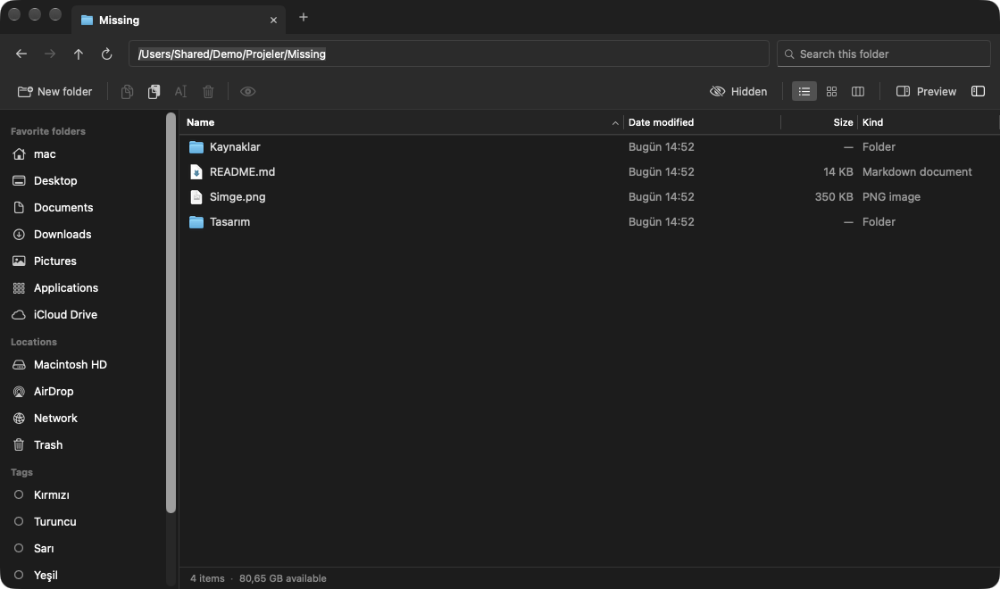</div>

### Sekme değiştirici (⌘")

**⌘** basılı tutup **"** tuşuna bas (ABD klavyesinde **`**): sekmelerin Missing'in ⌘Tab'ındaki gibi kartlarla, pencerenin tam ortasında açılır. Her basış bir sonraki sekmeye geçer, **⇧** geri gider; ⌘'yi bırakınca seçilen sekmeye geçilir. **Esc** vazgeçer, karta tıklamak da seçer. Sağdaki ince sık kullanılanlar sütunundan bir klasöre tıklarsan aynı pencerede yeni sekmede açılır.

<div align="center">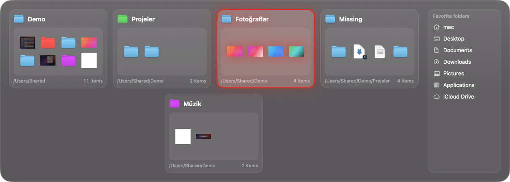</div>

**Ayarlar › Dosyalar › Sekme değiştirici**'den ⌘Tab'daki gibi liste görünümüne geçebilir, kartlardaki klasör içeriğini gizleyebilir ya da sık kullanılanlar sütununu kapatabilirsin.

<div align="center">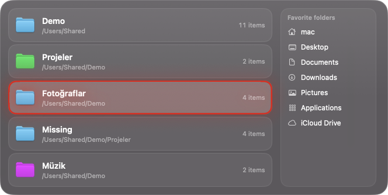</div>

### Kenar çubuğu

- **Sık kullanılanlar:** Finder'ın kenar çubuğuyla iki yönlü eşitlenir. Buraya eklediğin klasör Finder'da da çıkar, tersi de geçerli.
- **Konumlar:** diskler (çıkarma düğmesiyle), iCloud Drive, Google Drive, OneDrive, Dropbox gibi bulut klasörleri, ana klasör, AirDrop, Ağ ve Çöp Sepeti.
- **Etiketler:** Finder'ın etiketleri renkleriyle. Birine tıklayınca o etiketi taşıyan bütün dosyalar listelenir.
- **Son Kullanılanlar, Çöp Sepeti ve Ağ** Dosyalar'ın içinde açılır. Çöp Sepeti kendi sayfasından boşaltılır; Ağ sayfası dosya paylaşan bilgisayarları bulur ve **Sunucuya bağlan** sunar.

Bir öğeye sağ tıklayıp **Kenar çubuğundan gizle**'yi seç ya da nelerin görüneceğini **Dosyalar Ayarları**'ndan (**⌘,**) belirle. Bölümleri sıralamak için başlığı sürükle ya da başlığa sağ tıklayıp **Yukarı taşı** / **Aşağı taşı**'yı seç. **Ayarlar › Dosyalar › Kenar çubuğu düzeni**'nden de başlıkları, sıralarını ve klasörlerini düzenleyebilirsin.

### Renkler ve yeni klasör

**⇧⌘N** küçük bir Yeni klasör penceresi açar: adı yaz, rengini seç, Enter'a bas. Bir dosyaya ya da klasöre sağ tıklayınca Finder'daki renk noktaları çıkar. Renk bir Finder etiketidir, yani Finder'da da görünür; renkli klasörler macOS Tahoe'daki gibi o renge boyanır.

<div align="center">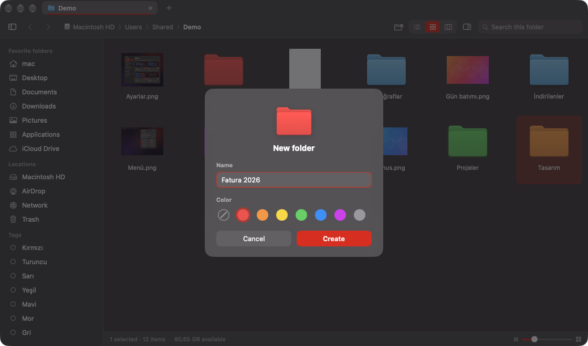</div>

### Kopyalama ve taşıma

Klasörler, sekmeler, kenar çubuğu ve diğer uygulamalar arasında sürükle-bırak. Aynı diske bırakınca taşınır, başka diske bırakınca kopyalanır (her zaman kopyalamak için **⌥**'ye basılı tut). **⌘C / ⌘V** kopyalar, **⌥⌘V** kopyalananları buraya taşır.

Sürüklerken imlecin altındaki klasörün ağzı açılır ve temanın rengini alır. Üstünde biraz bekleyince klasör açılır, daha içeriye bırakabilirsin.

Süren her kopyalama sağ altta bir kartta görünür: ne kadarı gitti, ne kadarı kaldı, tahmini süre. **×** kopyalamayı iptal eder ve yarım kalan dosyayı siler. Durum çubuğu toplamı gösterir.

<div align="center">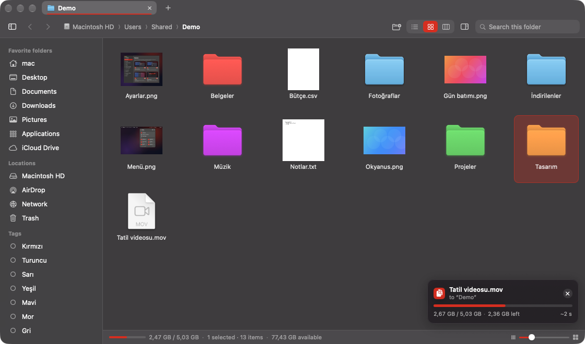</div>

### Arama

Arama kutusu (**⌘F**) önce o klasörü anında süzer, ardından ⌘Space aramasıyla aynı indeksle bütün alt klasörlere bakar. Alt klasörlerdeki sonuçlar nerede olduklarını gösterir; sık açtıkların öne çıkar.

### Gündelik tuşlar

**Return** yeniden adlandırır (uzantı değil, yalnız ad seçili gelir), **⌘D** çoğaltır, **⌘⌫** çöpe atar, **⌘Z** hepsini geri alır. **⌥⌘C** yolu kopyalar, **⇧⌘.** gizli dosyaları gösterir. Sağ tıkta Birlikte Aç, Paylaş, Yolu kopyala ve Terminal'de aç var.

Simge ve liste görünümünde bir adın ilk harflerini yazınca o öğe seçilir. Başka bir uygulama öndeyken de tek tıklama çalışır.

### Sağ tık menüsü

Dosyalar'ın kendi sağ tık menüsü var: simgeler, kısayollar ve yana açılan alt menüler.

- **Hızlı işlemler** dosya türüne göre: görseli döndür, dönüştür ya da boyutlandır, görsellerden PDF oluştur, PDF'leri birleştir, videoyu dönüştür ya da küçült, sesi çıkar ya da dönüştür; ses ve video için **Düzenle…**.
- **Bilgi al (⌘I)**, **Sıkıştır** / **Buraya aç**, **Takma ad oluştur**, **Paket içeriğini göster** ve iCloud için **Şimdi indir** / **İndirileni kaldır**.
- **Paylaş**, AirDrop, Mail, Mesajlar ve diğer servisleri temaya uyan bir menüde açar.

### Dock'ta

Dosyalar penceresi açıkken Missing, Dock'ta Finder gibi mavi klasör simgesiyle görünür. Ayarlar'da **Dock'a ekle**'ye bas ya da simgeye sağ tıklayıp Seçenekler › **Dock'ta Tut**'u seç; simgeye tıklayınca pencere her zaman açılır. Simgeye sağ tıklayınca **Son klasörler** çıkar.

**Ayarlar › Dosyalar**'da başta kapalı iki seçenek var: **Dock'taki Finder** açıkken Dock'ta Finder'a tıklayınca Dosyalar açılır (gerçek Finder için ⌥'ye basılı tut); **Finder yerine Dosyalar** açıkken başka uygulamalardaki "Finder'da göster" ve masaüstündeki klasörler Dosyalar'da açılır.

## Çentikten ekran bölme

<div align="center">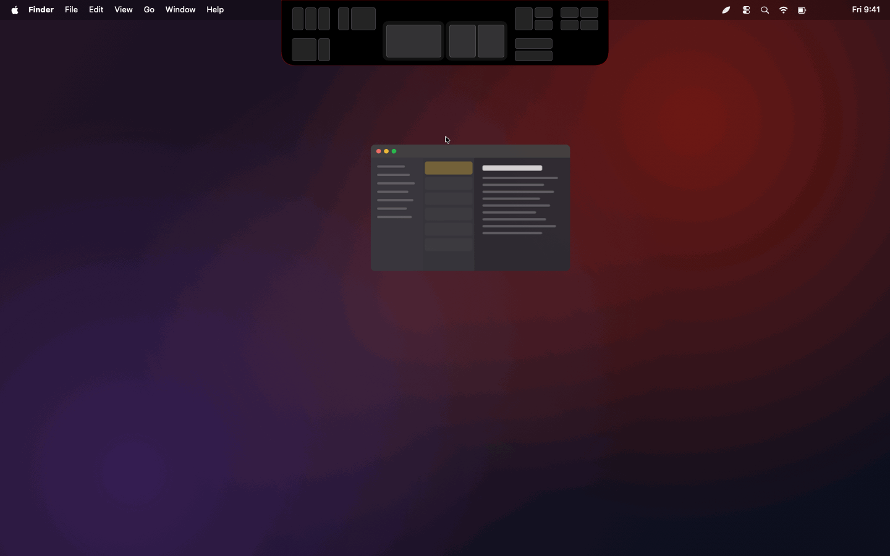</div>

Bir pencereyi ekranın üstüne sürükle. Çentikli MacBook'larda çentik, iki yanında düzenler olan bir adaya dönüşür. En çok kullandığın iki düzen çentiğin hemen altında durur ve kullandıkça güncellenir. Pencereyi bir bölmeye bırak, oraya yerleşsin. Ya da **⌘<** ile düzen seç: pencere pencere doldur ya da bölmeleri o ekrandaki son kullanılan pencerelerle Missing doldursun (Ayarlar › Ekran).

## Tek tuşla ses çıkışı

<div align="center">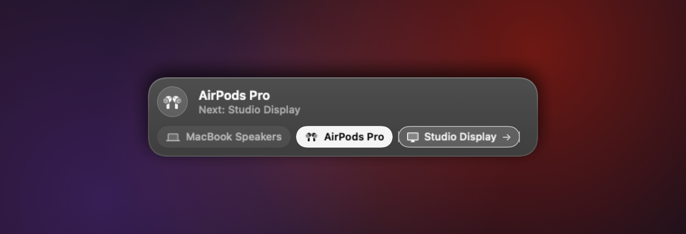</div>

**⌘** basılıyken **⇧**'ye dokun, sıradaki çıkışa geç: hoparlör → AirPods → ekran. Uygulamaya göre cihaz ata; o uygulama öne gelince ses ona geçer.

## Basit ekolayzır

<div align="center">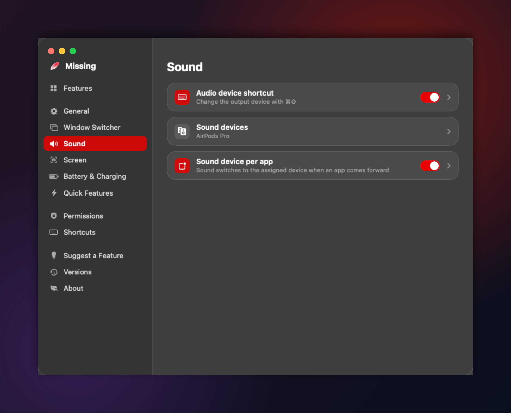</div>

Sistemin bütün sesi için 32 Hz – 16 kHz arası 10 bant (±12 dB) ve ön kazanç; hazır ayarlar: Düz, Bas, Tiz, Konuşma, Gece. macOS'un kendi ses yakalama özelliğini kullanır (macOS 14.2+): sürücü yok, ek uygulama yok. Çıkış cihazını değiştirince seninle gelir. İlk seferde macOS bir kez ses kaydı izni sorar; hiçbir şey kaydedilmez.

### Ses dengeleyici

Kısık sesi açar, yüksek sesi kısar; Mac'ten çıkan her ses seçtiğin **Hedef seviye**'de çalar. Sessiz anlarda ve cümle aralarında ses açılmaz, ani yüksek sesler taşmadan kısılır. **Ayarlar › Hızlı Özellikler**'den ya da menü çubuğu panelinden açılır; ekolayzırla aynı ses yolunu kullanır.

## LinearMouse ve Mos'suz fare

<div align="center">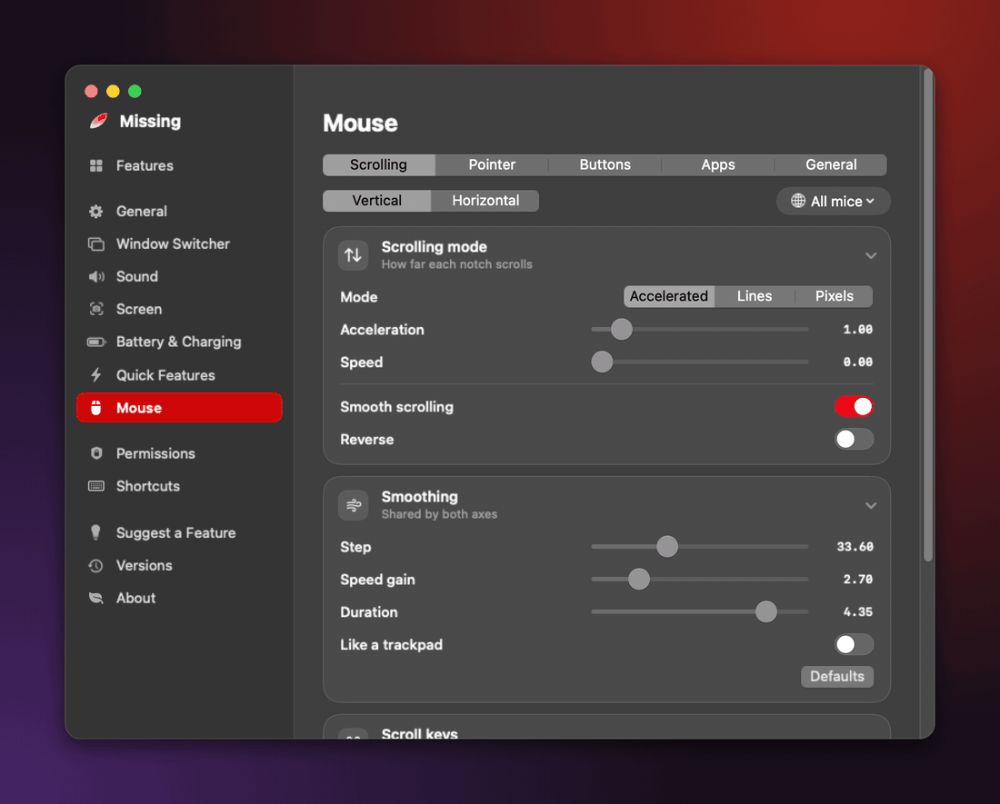</div>

**Ayarlar › Mouse**'u aç. Mos gibi hissettiren yumuşak kaydırma (adım, hız çarpanı, süre, trackpad gibi), LinearMouse'un kaydırma modları (ivmeli, satır, piksel; bunlar da yumuşatılabilir) ve basılı tutunca hızlandıran, yön değiştiren ya da yumuşatmayı kapatan tuşlar.

- **İmleç:** ivmeyi kapat ya da ivme ve hızı ayrı ayarla. Missing kapanınca ya da çökerse imleç sistem ayarına döner.
- **Tuşlar:** evrensel geri/ileri, sol ve sağ tuşu değiştirme, çift tıklama koruması, orta tuşla otomatik kaydırma, hareketler ve herhangi bir tuşu ya da kısayolu bir eyleme bağlama (Mission Control, masaüstleri, ekran görüntüsü, medya tuşları, uygulama ya da dosya açma, komut çalıştırma).
- **Cihaza, ekrana ve uygulamaya göre:** her ayar tüm farelere, tek bir fareye, bir ekrana ya da bir uygulamaya uygulanabilir. Trackpad ve Magic Mouse'a dokunulmaz.
- LinearMouse ya da Mos ayarlarını **içe aktar**.

## Pil ve şarj profilleri

*Sadece 14 inç MacBook Pro M4 Pro'da; diğer Mac'lerde hiç görünmez.*

Fişten çekince ekran **600 nit** ayarına ve **60 Hz**'e iner, **Düşük Güç Modu** açılır. Şarja takınca **1600 nit (XDR)**, **ProMotion** ve **Yüksek Güç Modu**'na döner. Kendiliğinden olur; istersen menü çubuğundan elle de geçersin.

## Uyanık tut

Ekranın kapanmasını ve Mac'in uyumasını engelle: **süresiz** ya da **15 dakikadan 5 saate** hazır sürelerle. Menü çubuğu panelinden tek bir seçim yap: bir süre ya da **seçtiğin uygulama açık kaldıkça** (listeden seç); kapatmak için aynısına tekrar bas. **⌘⇧<** de açıp kapatır. Açıkken menü çubuğundaki simge fincana döner, kalan süre çentiğin altında görünür.

- **Ekran ya da sadece Mac:** ekranı açık tut ya da ekran kapansın, Mac indirmeye ya da uzun işe devam etsin.
- **Otomatik:** sadece şarjdayken, pil azalınca kapat, Missing açılınca başlat.
- **Çantada güvenli:** kapağı kapatınca Mac yine uyur ve uyanık tut kendiliğinden kapanır, sonradan devam etmez. Yönetici şifresi gerekmez.
- **İstersen kapak kapalıyken de:** isteğe bağlı bir ayarla Mac kapak kapalıyken çalışmaya devam eder (bir kez yönetici şifresi ister). Şarjdan çekince, harici ekranı çıkarınca, süre sınırı dolunca ya da pil azalınca yine uyur.

## Gerisi bir tık uzakta

<div align="center">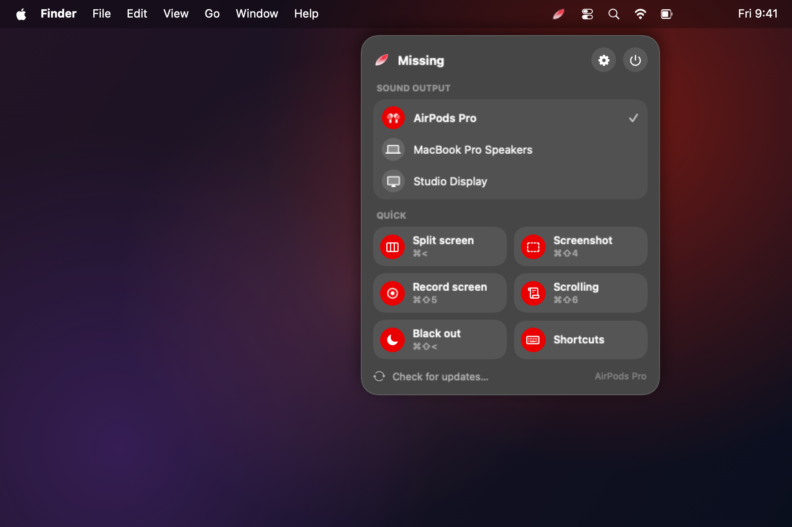</div>

Menü çubuğundaki yaprağa tıkla: üstte ses çıkışı, altında hızlı eylemler (ekranı böl, ekran görüntüsü, kayıt, kaydırmalı görüntü) ve harici ekranlar için parlaklık kaydırıcıları.

- **Ekran görüntüsü ve kayıt:** ⌘⇧3 bulunduğun ekran, ⌘⇧4 alan, ⌘⇧6 kaydırmalı sayfa, ⌘⇧5 MP4 kayıt. ⌘⇧5 paletinden **sadece bir pencereyi** çekebilir ya da kaydedebilirsin; kendi kayıt klasörüyle.
- **Hızlı özellikler:** ekolayzır, ses dengeleyici, Dosyalar penceresi, gruplu ⌘Tab görünümü, Finder'da fare tuşlarıyla geri/ileri, dosya sürüklerken Dock'ta anında açılma.

## Sadece kullandıkların

<div align="center">
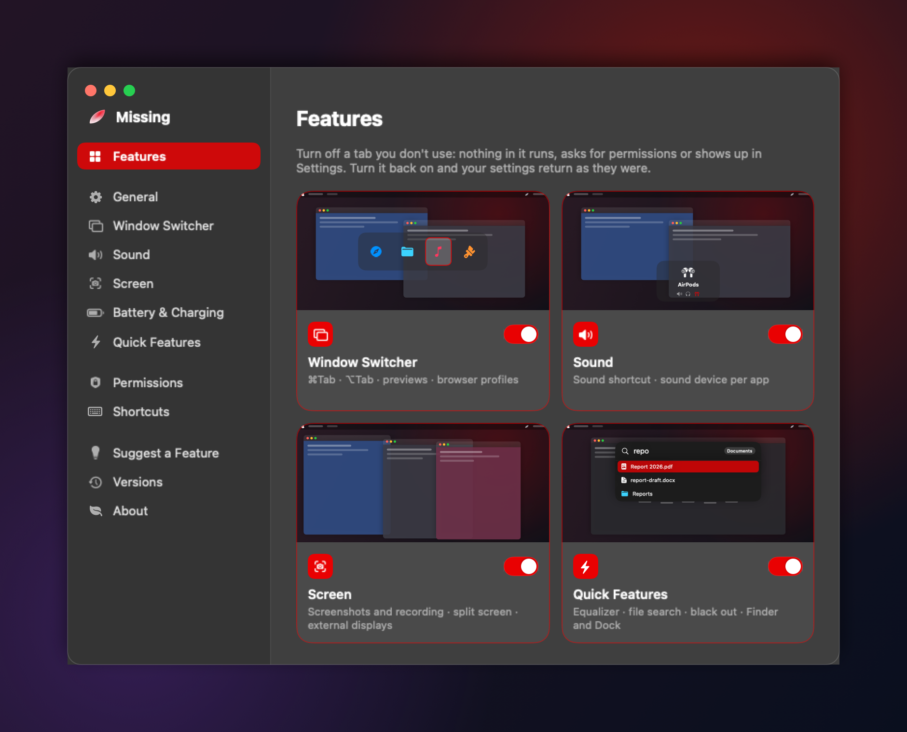
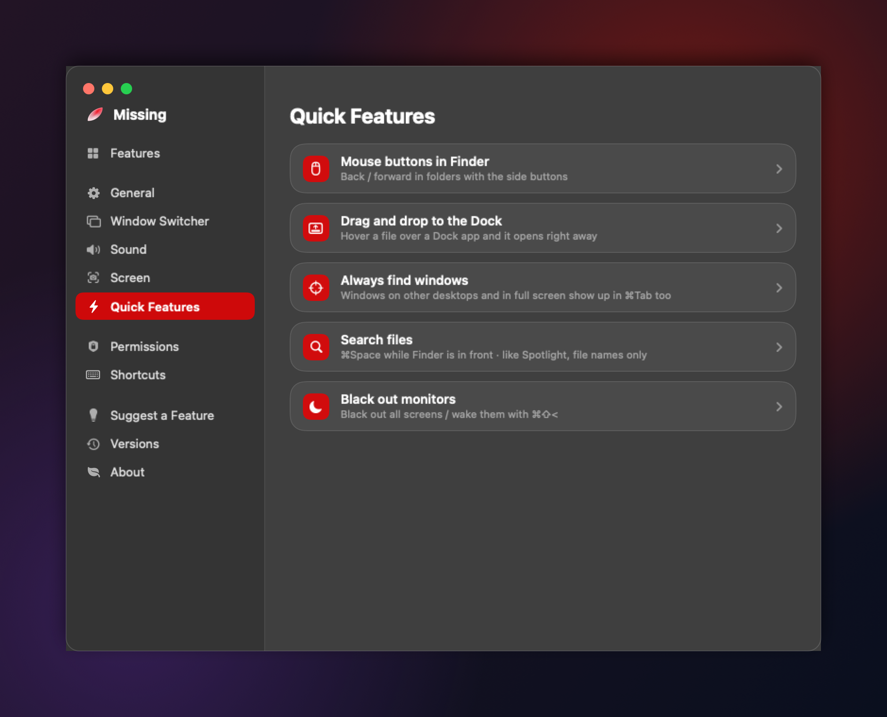
</div>

**Ayarlar › Özellikler** sekmelerin tamamını açıp kapatır: Pencere Değiştirici, Ses, Ekran ve Hızlı Özellikler, her biri canlı önizlemeyle. Kapattığın sekme tamamen kaybolur: kenar çubuğundan, menü panelinden, kısayol listesinden ve izinler sayfasından. İçindeki hiçbir şey çalışmaz, izin istemez. Tekrar açınca ayarların kaldığı gibi geri gelir. Sekmelerin içinde her seçeneğin yine kendi düğmesi var.

## Kısayollar

<div align="center">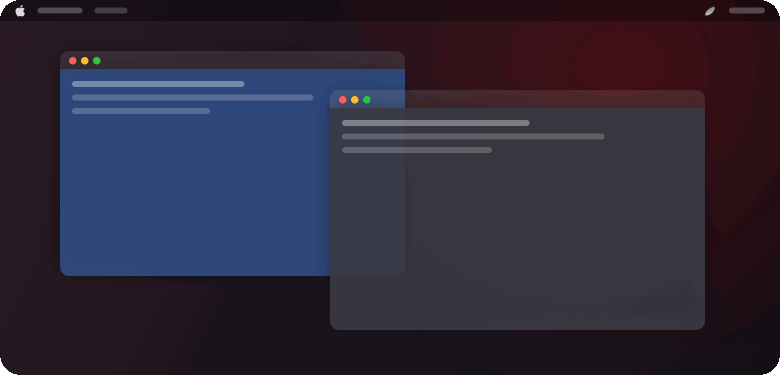</div>

**Ayarlar › Kısayollar** her kısayolun ne yaptığını kısa bir animasyonla gösterir.

| Kısayol | Ne yapar |
|---|---|
| ⌘Tab / ⌥Tab | Pencere değiştir (⌥Tab önizlemeli) |
| ⌘⇧ (⇧'ye dokun) | Sıradaki ses çıkışı |
| ⌘< | Ekranı böl |
| ⌘⇧< | Uyanık tut aç / kapat |
| ⌘⇧3 · ⌘⇧4 · ⌘⇧5 · ⌘⇧6 | Ekran · alan · kayıt · kaydırmalı görüntü |
| ⌘Space (Finder'da) | Dosya ara |
| ⌘" (Dosyalar'da) | Sekme değiştir |
| Space (Dosyalar'da) | Önizleme |
| Space · S · I / O · ⌫ · ⌘S (editörde) | Oynat · böl · aralık başı / sonu · çıkar · kaydet |

## Sende ne eksik?

Mac'in unuttuğu, atladığı ya da yarım bıraktığı bir özellik mi var? **[Buradan öner](https://github.com/firewallstudio/Missing/issues/new?template=feature_request.yml)**, beğendiğin [önerilere](https://github.com/firewallstudio/Missing/issues?q=label%3Aidea) 👍 ver; en çok istenenler önce gelir. Formu uygulamada **Ayarlar › Özellik iste**'den de açabilirsin.

## Kurulum

```bash
curl -fsSL https://raw.githubusercontent.com/firewallstudio/Missing/main/install.sh | bash
```

Ya da [Releases](https://github.com/firewallstudio/Missing/releases/latest) sayfasından `Missing.zip`'i indirip `Missing.app`'i **Uygulamalar** klasörüne sürükle.

<div align="center">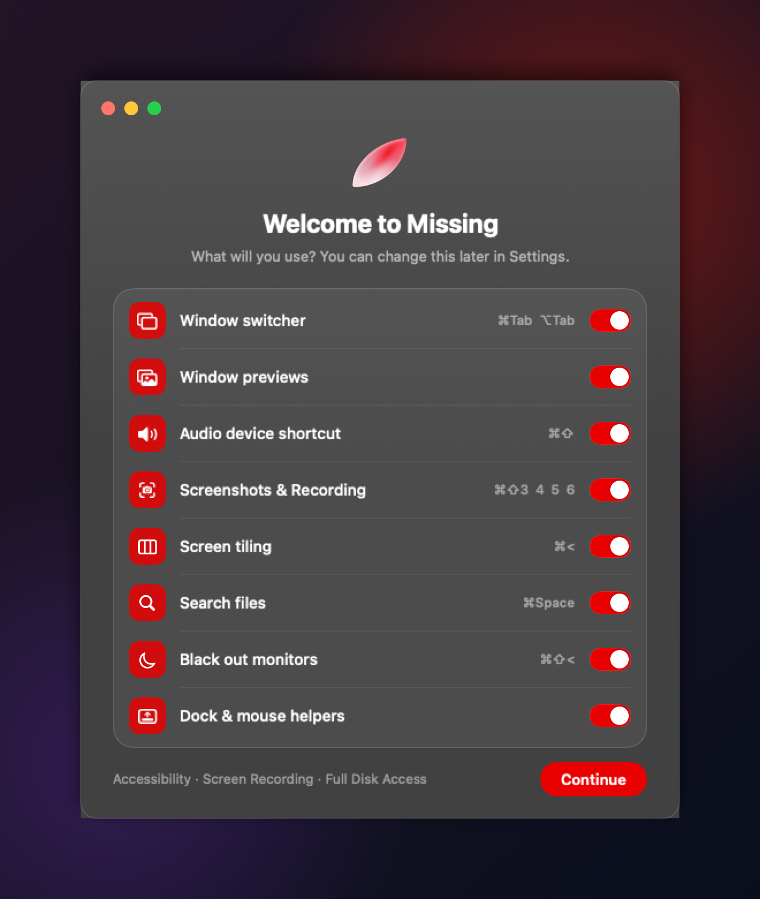</div>

İlk açılışta Missing hangi özellikleri kullanacağını sorar ve sadece onların gerektirdiği izinleri ister. Her şeyi sonra **Ayarlar**'dan değiştirebilirsin.

Missing, Apple'ın ücretli geliştirici programında değil. Zip'i tarayıcıdan indirdiysen ve macOS engellerse **Sistem Ayarları › Gizlilik ve Güvenlik**'te **Yine de Aç**'a bas ya da `xattr -dr com.apple.quarantine /Applications/Missing.app` çalıştır.

## Gizlilik

Mac'inden hiçbir şey çıkmaz. Tek ağ isteği GitHub'daki güncelleme denetimidir. Dosya arama sadece bu Mac'te dosya adlarının indeksini tutar; dosya içerikleri okunmaz.

## Derleme

```bash
./build.sh             # bu Mac için Missing.app
./build.sh --install   # derle ve /Applications'a kur
./release.sh           # VERSION'daki sürümü imzalayıp yayınlar (Missing Code Signing anahtarı gerekir)
```

Tüm sürümler aynı sertifikayla imzalanır (`signing/Missing.pem`, "Missing Code Signing"); macOS izinlerini güncellemelerde korur, güncelleyici de sadece bu sertifikayla imzalı sürümleri kurar. 4.3.22'ye kadarki sürümler `signing/AudioTab.pem` ile imzalıydı; onlardan 4.3.23 ve sonrasına geçmek için bir kere elle indirmek gerekir ve macOS Missing'in izinlerini bir kez yeniden ister.

<sub>Görseller Missing'in gerçek arayüzünü gösterir; arka plandaki pencere içerikleri temsilidir.</sub>
