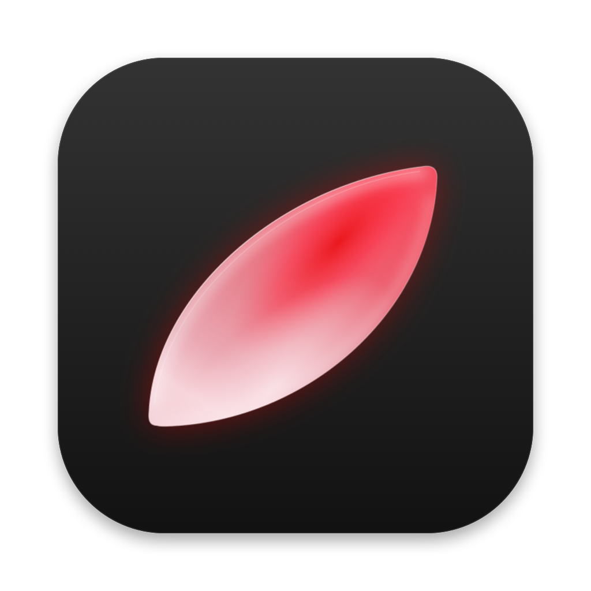

<div align="center">



# Missing

**Mac'te eksik kalan özellikler, menü çubuğunda tek hafif bir uygulamada.**

[**İndir**](https://github.com/firewallstudio/Missing/releases/latest) · [Kurulum](#kurulum) · [Kısayollar](#kısayollar) · [**English**](README.md)

</div>

---

Mac harika, ama her gün kullandığımız bazı şeyler ya hiç yok ya da yarım bırakılmış. ⌘Tab pencereleri değil uygulamaları gösterir. Ses çıkışını değiştirmek menülerde dolaşmak ister. Ekranı bölmek, uzun bir sayfanın görüntüsünü almak ya da bir dosyayı adından bulmak için ayrı ayrı uygulama aramak gerekir.

Missing unutulmuş bu özellikleri tek yerde toplar; her biri macOS'un parçasıymış gibi davranır. İstemediğini kapatırsın: kapattığın özellik ne izin ister ne de çalışır.

## Özellikler

| | |
|---|---|
| **Pencere pencere ⌘Tab** | Uygulamalar değil pencereler, canlı önizlemeyle. Tüm tarayıcı profilleri, diğer masaüstleri, tam ekran pencereler. Bir kartın üstüne dosya bırakırsan o uygulamayla açılır. |
| **Tek tuşla ses çıkışı** | ⌘ basılıyken ⇧'ye dokun: hoparlör → kulaklık → monitör. Uygulamaya göre cihaz atayabilirsin. |
| **Ekranı böl** | ⌘< ya da pencereyi ekranın üstüne (MacBook'ta çentiğe) sürükle, düzeni seç. |
| **Ekran görüntüsü ve kayıt** | ⌘⇧3 bulunduğun ekran, ⌘⇧4 alan, ⌘⇧6 kaydırmalı sayfa, ⌘⇧5 MP4 kayıt. |
| **Finder'da dosya arama** | Finder öndeyken ⌘Space: Spotlight gibi bir çubuk, bulunduğun klasörde dosya adına göre anında arar. |
| **Hızlı özellikler** | Gruplu ⌘Tab görünümü, Finder'da fare ile geri/ileri, Dock'a sürükle-bırak, ⌘⇧< ile tüm ekranları karartma. |

Boştayken hiçbir şey yapmaz; internete sadece güncelleme denetimi için çıkar. Yerel Swift.

## Kurulum

```bash
curl -fsSL https://raw.githubusercontent.com/firewallstudio/Missing/main/install.sh | bash
```

Ya da [Releases](https://github.com/firewallstudio/Missing/releases/latest) sayfasından `Missing.zip`'i indirip `Missing.app`'i **Uygulamalar** klasörüne sürükle.

İlk açılışta Missing hangi özellikleri kullanacağını sorar ve sadece onların gerektirdiği izinleri ister. Her şeyi sonra **Ayarlar**'dan değiştirebilirsin.

Missing, Apple'ın ücretli geliştirici programında değil. Zip'i tarayıcıdan indirdiysen ve macOS engellerse **Sistem Ayarları › Gizlilik ve Güvenlik**'te **Yine de Aç**'a bas ya da `xattr -dr com.apple.quarantine /Applications/Missing.app` çalıştır.

## Kısayollar

| Kısayol | Ne yapar |
|---|---|
| ⌘Tab / ⌥Tab | Pencere değiştir (⌥Tab önizlemeli) |
| ⌘⇧ (⇧'ye dokun) | Sıradaki ses çıkışı |
| ⌘< | Ekranı böl |
| ⌘⇧3 · ⌘⇧4 · ⌘⇧5 · ⌘⇧6 | Ekran · alan · kayıt · kaydırmalı görüntü |
| ⌘Space (Finder'da) | Dosya ara |
| ⌘⇧< | Ekranları karart |

**Ayarlar › Kısayollar** her birini animasyonla gösterir.

## Derleme

```bash
./build.sh             # bu Mac için Missing.app
./build.sh --install   # derle ve /Applications'a kur
```

Tüm sürümler aynı sertifikayla imzalanır (`signing/AudioTab.pem`); macOS izinlerini güncellemelerde korur, güncelleyici de sadece bu sertifikayla imzalı sürümleri kurar.
